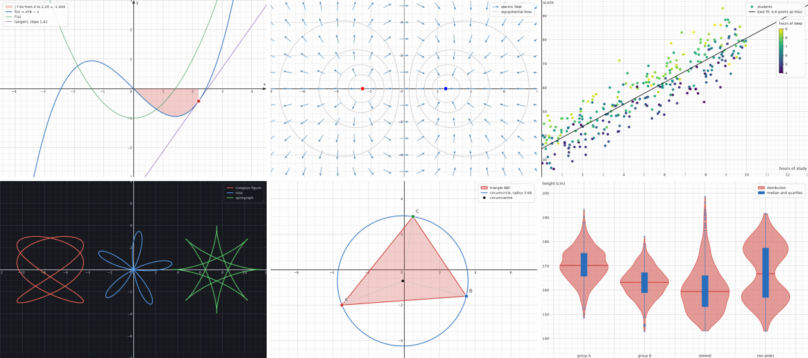

# PyGridPlot

**Interactive, zoomable Cartesian planes for [pygame-ce](https://pyga.me/).**
Plot functions, curves, fields and data, give the user points and sliders
to drag, and draw it all from your own main loop.



PyGridPlot draws a plane in the spirit of the Desmos graph view, driven
from Python: give it NumPy or `math` functions, numbers and arrays, and it
draws them antialiased, over a grid whose lines and labels adapt as you pan
and zoom. It is a library, not a framework: your program owns the loop,
and the plane, a `pgp.Grid`, is an object you call each frame.

## Installing

```bash
pip install pygridplot
```

PyGridPlot needs Python 3.10 or newer; pip installs
[pygame-ce](https://pyga.me/), NumPy and contourpy with it. pygame-ce, the
community edition of pygame, installs under the same name as the original
`pygame`, so uninstall that first if you have it (`pip uninstall pygame`).
Recording videos also needs [ffmpeg](https://ffmpeg.org), a free program
installed separately (or with `pip install imageio-ffmpeg`): see
[Setting up ffmpeg](docs/user/export.md#setting-up-ffmpeg). Nothing else
needs it.

## A first program

```python
import numpy as np
import pygame
import pygridplot as pgp

pygame.init()
screen = pygame.display.set_mode((960, 640), pygame.RESIZABLE)
clock = pygame.time.Clock()
grid = pgp.Grid()                       # fills the window, follows resizes

running = True
while running:
    for event in pygame.event.get():
        if event.type == pygame.QUIT:
            running = False
        grid.handle_event(event)        # drag to pan, scroll to zoom

    grid.draw(screen)                   # the grid, axes and labels
    grid.plot(screen, np.sin, label="sin x")
    grid.plot(screen, np.tan, label="tan x")    # asymptotes are not joined up
    grid.legend(screen)
    pygame.display.flip()
    clock.tick(60)
pygame.quit()
```

Each frame draws the grid, then whatever you want on top of it; there are
no plot objects to create or update. For a quick look without a loop:
`pgp.show(np.sin, lambda x: x**2)`.

## What it draws

- [**Functions and calculus**](docs/user/functions.md): graphs of `y = f(x)`,
  with exact derivatives of any order, integrals and antiderivatives,
  Taylor polynomials and Fourier series, all as functions to plot.
- [**Curves**](docs/user/curves.md): parametric, polar and implicit
  (`F(x, y) = c`), and contour maps.
- [**Regions and fields**](docs/user/regions-and-fields.md): the area
  between two graphs, regions where inequalities hold, and vector and slope
  fields.
- [**Shapes and text**](docs/user/shapes-and-text.md): polygons, arrows,
  text at points of the plane and legends; and the terms of
  [sequences](docs/user/functions.md#sequences).
- [**Data**](docs/user/data.md): scatter plots coloured and sized by a
  value with a colour bar, error bars, step plots, bar charts (stacked,
  floating, horizontal), histograms, box and violin plots, and names along
  an axis.
- [**Interaction**](docs/user/draggable-points.md): points the user drags
  (freely, along a line or along a curve), sliders for numbers (with a
  play button that sweeps them, as in Desmos), checkboxes for switches,
  and smooth [panning and zooming](docs/user/interaction.md).
- [**Axes**](docs/user/the-plane.md): linear or
  [logarithmic](docs/user/log-axes.md), set up from ranges like a graphing
  calculator's window, with titles and arrowheads.
- [**Line styles**](docs/user/styles-and-themes.md#dashed-and-dotted-lines):
  dashed and dotted curves, polylines and outlines, whose dashes stay put
  while you pan.
- [**Pictures and videos**](docs/user/export.md): save the plane as a
  picture at any resolution, and record videos (MP4, WebM, GIF, through
  ffmpeg) with a quick draft and a sharp final version from one program.

## Why PyGridPlot

- **It looks right without settings.** Grid lines are 1-2-5 steps that fade
  in and out as you zoom, labels are exact decimals that never overlap and
  stay on screen, logarithmic axes thin out and subdivide properly, and
  dashes stay fixed to their lines while you pan.
- **It is hard to break.** Functions may raise errors, return NaN or
  infinity, or only take single numbers: the plot just has a gap. Poles and
  jumps are never joined up, and curves end exactly where they stop being
  defined.
- **It is immediate.** Each frame draws what you want from your own
  variables, so animation and interactivity need nothing special.
- **It is fast.** Sampling spends its effort where curves bend, the hot
  paths are vectorised, and plots that did not change since the last frame
  are reused automatically and exactly.
- **It fits into pygame.** A plane can fill the window or a rectangle of
  it, beside your own drawing, and passes on the events it does not use.

## Examples

The [`examples/`](examples/) folder has 24 short programs, from the first
program above to calculus with a draggable tangent, Fourier series with a
slider, the field of two charges you can move, data plots, and a plane
inside a game. The [examples page](docs/user/examples.md) shows each one.

```bash
python examples/calculus.py
```

## Documentation

- [Getting started](docs/user/getting-started.md): installing, the first
  program, how a frame works.
- The [user guide](docs/user/index.md): the plane, interaction, every kind
  of plot, draggable points, sliders and checkboxes, logarithmic axes,
  styles and themes, saving pictures and videos, and recipes for common
  tasks.
- The [API reference](docs/user/reference.md): every class, method and
  setting.
- The [philosophy](docs/philosophy.md) behind the design, and the
  [developer guide](docs/dev/index.md) for working on PyGridPlot itself.
- The [changelog](CHANGELOG.md).

## Licence

PyGridPlot is free software: you can redistribute it and modify it under
the terms of the [GNU Lesser General Public License](LICENSE), version 2.1
or (at your option) any later version, the licence pygame-ce uses. In
short, programs that use PyGridPlot may be under any licence, while
changed versions of PyGridPlot itself stay under the LGPL; the licence
text has the terms. The bundled label font, DejaVu Sans, comes with its own
permissive licence
([`LICENSE-DejaVu.txt`](src/pygridplot/assets/fonts/LICENSE-DejaVu.txt)).

Copyright © 2026 GWStuart.
