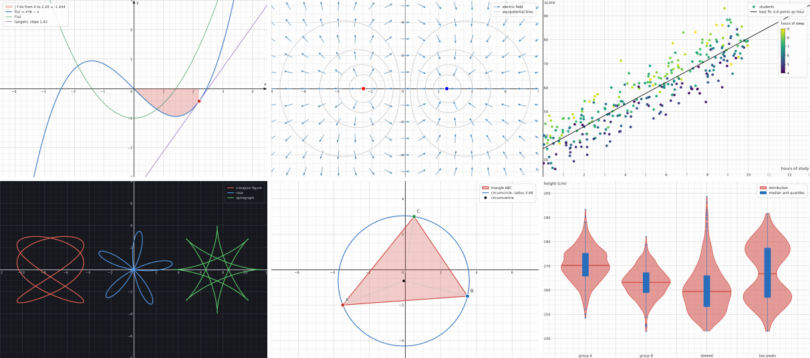

# PyGridPlot documentation

PyGridPlot draws interactive, zoomable Cartesian planes in
[pygame-ce](https://pyga.me/) windows: functions and curves, regions and
fields, data, and points and sliders the user can drag, over a grid whose
lines and labels adapt as you pan and zoom. Your program owns the main
loop, and the plane, a `pgp.Grid`, is an object you call every frame.

New to it? Start with [Getting started](user/getting-started.md), then
look through the [examples](user/examples.md).

The [philosophy](philosophy.md) explains the principles behind it: one way
to do things, done well; Python first; a library, not a framework; and
immediate mode.

## For users

Start with [Getting started](user/getting-started.md), then read whichever
topic you need:

| Page | What it covers |
|---|---|
| [Getting started](user/getting-started.md) | Installing, the first program, the frame loop, quick mode. |
| [Examples](user/examples.md) | Every example program, with a picture of it. |
| [The plane](user/the-plane.md) | Creating a plane, setting up the view, coordinates, embedding, several planes. |
| [Interaction](user/interaction.md) | The built-in controls, configuring them, moving the view from code. |
| [Plotting](user/plotting.md) | Every plotting method at a glance, drawing order, reusing unchanged plots. |
| [Functions and calculus](user/functions.md) | Functions, derivatives, integrals and antiderivatives, Taylor polynomials, Fourier series, sequences. |
| [Curves](user/curves.md) | Parametric, polar and implicit curves, contour lines. |
| [Regions and fields](user/regions-and-fields.md) | Areas between graphs, inequalities, vector and slope fields. |
| [Data](user/data.md) | Scatter plots, error bars, lines and steps, bars, histograms, box and violin plots, colour by value. |
| [Shapes, text and legends](user/shapes-and-text.md) | Polygons, arrows, text and legends. |
| [Draggable points, sliders and checkboxes](user/draggable-points.md) | Points the user drags: free, locked to an axis, or on a curve; sliders for values, which can play; checkboxes for switches. |
| [Logarithmic axes](user/log-axes.md) | Log and semi-log planes, how their grid and labels behave. |
| [Styles and themes](user/styles-and-themes.md) | Colours, reusable styles, dashed and dotted lines, the palette, themes and number formats. |
| [Saving pictures and videos](user/export.md) | Pictures at any resolution; videos (MP4, WebM, GIF) through ffmpeg, and how to set it up. |
| [Recipes](user/recipes.md) | Worked examples of common tasks, performance tips and troubleshooting. |
| [API reference](user/reference.md) | Every public class, function and setting, generated from the code. |

## For developers

The [developer guide](dev/index.md) explains how the code is organised and
how to extend it:

| Page | What it covers |
|---|---|
| [Architecture](dev/architecture.md) | Design principles, layers, the package map, what happens in a frame. |
| [The grid](dev/grid.md) | Spacing, lines, labels, layout and log axes, step by step. |
| [Plotting](dev/plotting.md) | Robust evaluation, the samplers, exact derivatives (Taylor arithmetic), adaptive quadrature, building primitives. |
| [Draggable points, sliders and checkboxes](dev/dragging.md) | Events, constraints, following curves, labels, the panels of sliders and checkboxes, playing, and the legend's panel. |
| [Rendering](dev/rendering.md) | The renderer protocol, rasterising, compositing, text and performance. |
| [Testing and tools](dev/testing.md) | How the code is tested, and the visual and benchmark tools. |
| [Extending PyGridPlot](dev/extending.md) | Step-by-step recipes for new features, and the coding conventions. |
