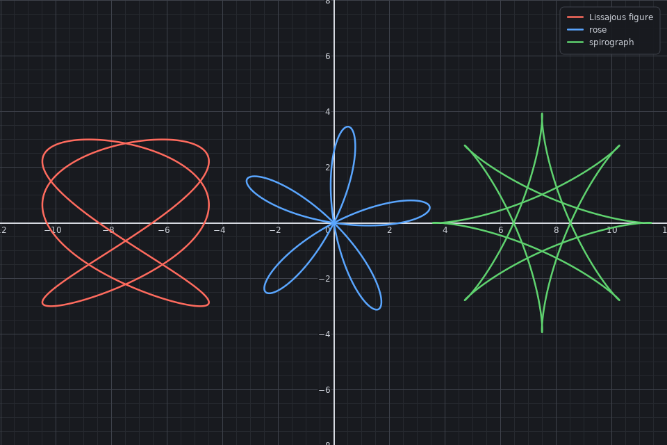
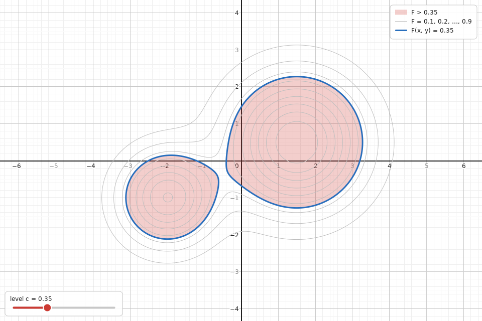

# Curves

Curves that are not graphs of a function of x: parametric curves
`(x(t), y(t))`, polar curves `r(θ)`, and implicit curves `F(x, y) = c`,
which also draw contour maps. All of them are sampled more finely where
they bend, so they stay smooth at any zoom.



*A Lissajous figure, a rose and a spirograph, moving, on the dark theme ([`examples/curves.py`](../../examples/curves.py))*

On this page: [Parametric curves](#parametric-curves) · [Polar curves](#polar-curves) · [Implicit curves](#implicit-curves).

## Parametric curves

```py
grid.parametric(surface, x, y, t_range, *, color=None, width=None,
                 opacity=None, style=None, sampling=None)
```

```python
grid.parametric(screen, np.cos, np.sin, (0, 2 * np.pi))               # unit circle
grid.parametric(screen, lambda t: t - np.sin(t), lambda t: 1 - np.cos(t), (0, 20))
grid.parametric(screen, 2.0, lambda t: t, (-1, 1))                    # the segment x = 2
```

The curve is the point `(x(t), y(t))` as `t` runs over `t_range`, which you
always give (there is no natural default). `x` and `y` are written like the
functions given to `plot`, vectorised or not, and allowed to fail for some
`t`; either can also be a plain number. Points where a coordinate is
undefined are left out, and the curve ends exactly where it becomes
undefined. Jumps and poles are not joined up: `x = tan t` breaks into
branches, each running off the edge of the plane.

Curves are sampled adaptively *on screen*, so tight turns, cusps, loops and
spirals stay smooth at every zoom level, on linear and log axes alike.

## Polar curves

```py
grid.polar(surface, r, theta_range=(0, 2π), *, color=None, width=None,
            opacity=None, style=None, sampling=None)
```

```python
grid.polar(screen, lambda a: 2 * np.cos(3 * a))                   # three-petal rose
grid.polar(screen, lambda a: 1 + np.cos(a))                       # cardioid
grid.polar(screen, lambda a: 0.1 * a, (0, 10 * np.pi))            # spiral, 5 turns
grid.polar(screen, 1.5)                                           # circle of radius 1.5
```

The point at angle `θ` and radius `r(θ)` is `(r cos θ, r sin θ)`. Angles are
in radians, anticlockwise from the positive x axis, and a negative radius
lies on the opposite side of the origin, as usual in mathematics.
`theta_range` defaults to one full turn; spirals, and roses such as
`cos(θ / 3)`, need more. Where `r` is undefined, the curve has a gap that
ends exactly at the edge (`r = sqrt(cos 2θ)`, the lemniscate, reaches the
origin).

### Curve sampling settings

Parametric and polar curves share a `CurveSampling` configuration, passed
as `sampling=`:

| Field | Default | Meaning |
|---|---|---|
| `initial_samples` | `256` | Evenly spaced parameter values sampled first. |
| `tolerance_px` | `0.25` | Largest allowed distance between the curve and the drawn line. |
| `max_segment_px` | `24` | Longest segment drawn without checking in between. A segment that stays longer than this however much it is refined is treated as a jump. |
| `max_rounds` | `12` | Refinement depth beyond what the zoom level needs. |
| `max_samples` | `16384` | Budget of evaluations per curve per frame. |

The initial samples must be dense enough that no feature hides between two
of them, so a curve with a very large parameter range (hundreds of spiral
turns, say) may need more `initial_samples`.

## Implicit curves



*Contour lines, one level in bold and the region above it shaded ([`examples/implicit.py`](../../examples/implicit.py))*

```py
grid.implicit(surface, func, level=0, *, color=None, width=None,
               opacity=None, style=None, sampling=None)
```

```python
grid.implicit(screen, lambda x, y: x**2 + y**2, 4)                        # circle, radius 2
grid.implicit(screen, lambda x, y: x**3 + y**3 - 6 * x * y)               # folium of Descartes
grid.implicit(screen, lambda x, y: (x**2 + y**2)**2 - 8 * (x**2 - y**2))  # lemniscate
grid.implicit(screen, lambda x, y: x - np.sin(y))                         # x = sin y
```

An implicit curve is every point where `func(x, y)` equals `level` (0 by
default), so any equation can be drawn by moving everything to one side:
`x² + y² = 4` is `func = x² + y²` with `level = 4`, or `x² + y² - 4` with
the default level. The curve can have any shape: closed loops, several
separate pieces, branches that cross, parts that are not a function of
`x` or of `y`.

`func` takes two arguments, written like the functions given to `plot`:
NumPy (fast) or plain `math` (slower), allowed to raise errors or return
NaN where it is undefined. Where `func` changes sign without passing
through the level, at a pole or a jump, no line is drawn, and the curve
ends where `func` becomes undefined:

```python
grid.implicit(screen, lambda x, y: y - np.tan(x))      # branches, no asymptotes
grid.implicit(screen, lambda x, y: y - np.floor(x))    # steps, no risers
grid.implicit(screen, lambda x, y: y - math.sqrt(x))   # starts at x = 0
```

The curve is found again every frame on a grid of samples 2 pixels apart,
refined where it crosses the grid, so it is accurate to a small fraction
of a pixel at any zoom, on linear and log axes alike.

### Contour lines

Give a sequence of levels to draw one curve for each, all in the same
style, like the height lines of a map. This is much faster than one call
per level, because `func` is evaluated only once:

```python
def height(x, y):
    return np.sin(x) + np.cos(y)

grid.implicit(screen, height, np.linspace(-1.5, 1.5, 7), width=1.5)
grid.implicit(screen, height, 0, width=3)              # emphasise one level
```

### What implicit curves cannot do

- **`func` must change sign across the curve.** A curve where it only
  touches the level is not drawn: `(x - y)**2` is never negative, so
  `(x - y)**2 = 0` draws nothing (and nor does a region where `func`
  equals the level throughout). Write `x - y` instead. For the same reason
  a curve may break where two of its branches touch without crossing.
- **Features smaller than about 2 pixels may be missed**, such as a loop
  less than 3 pixels across, or two curves closer together than a pixel or
  two. Zoom in to see them, or sample more finely (below).
- **A curve stops within a pixel or two of where `func` becomes
  undefined**, rather than exactly at the edge as for `plot`.
- **A function of `x` is better drawn with `plot`**, and a curve with a
  known parametrisation with `parametric`: both are faster and treat
  domain edges exactly. Use `implicit` for the curves that have no simpler
  form.

### Implicit sampling settings

Pass an `ImplicitSampling` as `sampling=` to trade speed for detail:

| Field | Default | Meaning |
|---|---|---|
| `resolution_px` | `2.0` | Spacing of the sampling grid in pixels. Features smaller than this may be missed; halving it quadruples the work near the curve. |
| `coarse_factor` | `4` | The grid used to find where the curve might be is this many times coarser (1, 2, 4, 8 or 16; 1 samples everywhere). |
| `refine_steps` | `3` | Steps spent checking each crossing of the grid and moving it onto the curve. `0` skips the check, so poles and jumps would be drawn as lines. |
| `max_samples` | `250000` | Budget of evaluations per call per frame. Beyond it the grid is made coarser. |

```python
fine = pgp.ImplicitSampling(resolution_px=1.0)
grid.implicit(screen, lambda x, y: np.sin(x * y) - 0.5, sampling=fine)
```

The budget keeps slow functions usable: a plain `math` function costs
about 0.4 microseconds per evaluation (NumPy is tens of times faster), so
the default budget bounds a call at about 100 ms even in the worst case, a
curve that winds across the whole plane. Dense contour maps
on large windows can reach the budget with NumPy functions; raising
`max_samples` (to `10**6`, say) keeps them at full resolution.

