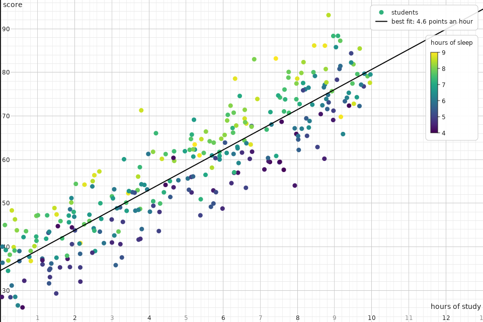
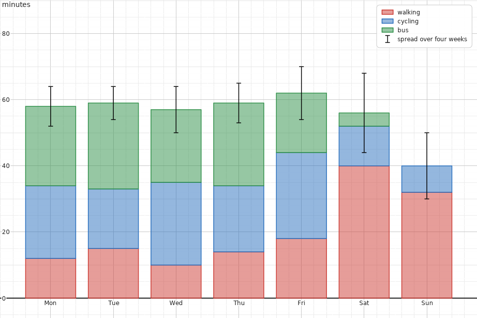
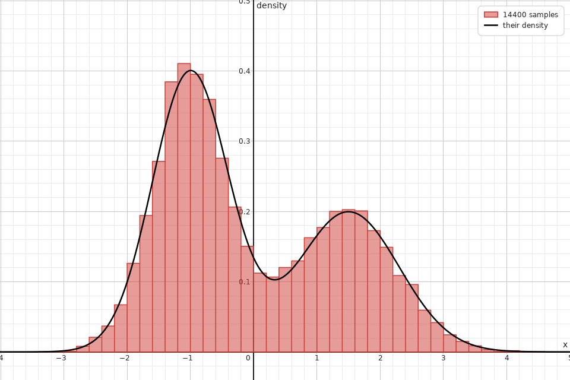
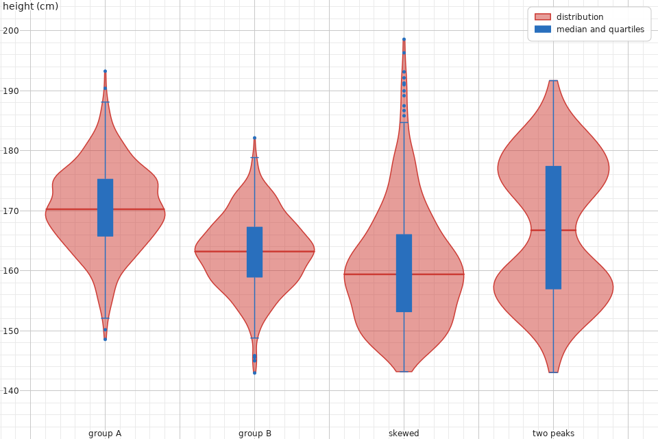

# Data

Data (measurements, samples, the state of a running simulation) drawn
from your own lists and arrays: scatter plots with a colour and a size per
point, error bars, lines and steps, bar charts, histograms, box and violin
plots, and colour by value with a colour bar.



*A scatter plot coloured by a third value, with a fitted line and a colour bar ([`examples/scatter.py`](../../examples/scatter.py))*

On this page: [Which method to use](#which-method-to-use) · [Points](#points) · [Polylines](#polylines) · [Bars](#bars) · [Histograms](#histograms) · [Box and violin plots](#box-and-violin-plots) · [Colour by value](#colour-by-value).

## Which method to use

Data is drawn with the same methods as everything else, from your
program's own lists and arrays, every frame:

| To draw | Use |
|---|---|
| A scatter plot | [`points`](#points), with a colour and a size per point if they show a value. |
| Error bars | `points(..., y_error=, x_error=)`; with `radius=0`, the bars alone. |
| A line through data | [`polyline`](#polylines); `step="post"` for steps (counts, held signals, an empirical distribution). |
| A bar chart | [`bars`](#bars), from heights or `(x, height)` pairs. |
| A histogram | [`histogram`](#histograms), from the raw samples (`cumulative=True` for a distribution). |
| Groups of samples compared | [`box_plot`](#box-and-violin-plots) or [`violin_plot`](#box-and-violin-plots). |
| A value shown by colour | [`pgp.color_map`](#colour-by-value) for `points(color=)`, and a [`color_bar`](#colour-by-value). |
| Stacked, floating or horizontal bars | [`bars`](#bars) with `baseline=` per bar, or `horizontal=True`. |
| Categories along an axis | `grid.draw(x_labels=["a", "b", ...])` (see [The plane](the-plane.md#categories-on-an-axis)). |
| A model or fit | [`plot`](functions.md#functions) of the function, over the data. |
| A band (a confidence interval) | [`fill_between`](regions-and-fields.md#areas-between-graphs) of `lambda x: np.interp(x, xs, low)` and `... high`. |

```python
rng = np.random.default_rng(1)
xs = np.arange(10.0)
ys = 0.5 * xs + rng.normal(0, 0.4, xs.size)
grid.points(screen, np.column_stack((xs, ys)), y_error=0.4, label="measured")
grid.plot(screen, lambda x: 0.5 * x, label="model")
grid.legend(screen, corner="top-left")
```

The data may change from frame to frame, in place or not: unchanged data
is [reused](plotting.md#reusing-unchanged-plots) (it is compared, not trusted), and
changed data is drawn again. To show the data at first, set the view from
it with `pgp.data_range`, which gives a range around values with a margin
(see [Setting up the view](the-plane.md#setting-up-the-view)):

```python
grid = pgp.Grid(x_range=pgp.data_range(xs), y_range=pgp.data_range(ys, include=0))
```

## Points

```py
grid.points(surface, points, *, color=None, radius=None, marker=None,
             edge_color=None, edge_width=None, opacity=None, x_error=None,
             y_error=None, error_width=None, error_cap=None, style=None)
```

```python
grid.points(screen, (1, 2))                                     # one point
grid.points(screen, [(0, 0), (1, 1), (2, 4)], marker="diamond")
xs = np.linspace(-3, 3, 25)
grid.points(screen, np.column_stack((xs, np.sin(xs))), edge_color="white")
```

`points` is a single point `(x, y)`, a sequence of points, or an `(N, 2)`
array (use `np.column_stack((xs, ys))` for separate arrays). Points with a
NaN coordinate are skipped. Markers keep the same size in pixels at every
zoom level, and are positioned to a quarter of a pixel, so they glide
smoothly while panning.

### A colour and a size per point

`color=` and `radius=` take one value for every point, or one per point,
for a scatter plot that shows a third value by colour or size:

```python
pts = np.random.default_rng(2).normal(size=(200, 2))
r = np.hypot(pts[:, 0], pts[:, 1])
shade = np.clip(r / 2.5, 0, 1)[:, None]
colors = (1 - shade) * (40, 100, 200) + shade * (220, 60, 40)   # blue to red
grid.points(screen, pts, color=colors, radius=2 + 3 * shade[:, 0])
grid.points(screen, [(-2, 2), (0, 2), (2, 2)], color=["crimson", "seagreen", "gold"])
```

A colour per point is a sequence of colours (names, or `(r, g, b)` and
`(r, g, b, a)` tuples) or an `(N, 3)` or `(N, 4)` array of values from 0
to 255; a sequence of three or four numbers is one colour. Colours per
point use no palette colour, and a legend entry shows the first. A size
per point is in pixels, rounded to a quarter of a pixel; NaN or 0 draws
no marker. Markers are drawn in order, each on top of the ones before. To
colour by category (clusters, say), one call per category is often
better: each gets a palette colour and a legend entry.

### Error bars

```python
grid.points(screen, [(1, 2), (2, 3)], y_error=0.5)                       # ± 0.5
grid.points(screen, [(1, 2), (2, 3)], y_error=[0.2, 0.4])                # one each
grid.points(screen, [(1, 2), (2, 3)], y_error=[[0.2, 0.4], [0.6, 0.1]])  # below, above
grid.points(screen, [(1, 2)], x_error=0.3, y_error=0.3, error_cap=0)     # no caps
```

`y_error` and `x_error` are one length for every point, one per point
(the same below and above), or two rows of one per point (below then
above, or left then right); NaN draws no bar for that point. The bars are
in world units, so they grow with the zoom, while their width and caps are
in pixels. They are drawn in the points' colour, under the markers (with a
colour per point, in the theme's label colour). `radius=0` draws the error
bars alone, to put them on [bars](#bars), say. On a log axis a bar
reaching zero or below runs off the plane, without a cap there.

| Parameter | Default | Meaning |
|---|---|---|
| `color` | next palette colour | Marker colour, or a colour per point. |
| `radius` | `4.5` | Size in pixels (other shapes have the same area as the circle), or a size per point; `0` for no marker. |
| `marker` | `"circle"` | `"circle"`, `"square"`, `"diamond"`, `"cross"` or `"plus"`. |
| `edge_color` | `None` | Outline colour, drawn *outside* the marker. A background-coloured outline (such as `"white"`) sets points apart from the curves they sit on. |
| `edge_width` | `1.5` | Outline thickness in pixels (only with `edge_color`). |
| `opacity` | `1.0` | Opacity, 0 to 1. |
| `x_error`, `y_error` | `None` | Error bar lengths (above). |
| `error_width` | `1.5` | Thickness of the error bars in pixels. |
| `error_cap` | `8` | Width of the caps across their ends, in pixels; `0` for none. |
| `style` | `None` | A reusable `PointStyle`. |

## Polylines

```py
grid.polyline(surface, points, *, color=None, width=None, opacity=None,
               dash=None, closed=False, step=None, style=None)
```

```python
grid.polyline(screen, [(0, 0), (1, 2), (3, 1)])
grid.polyline(screen, [(0, 0), (1, 0), (1, 1)], closed=True, width=1.5)
grid.polyline(screen, [(0, 0), (1, 1), (np.nan, np.nan), (2, 0), (3, 1)])  # two pieces
```

The vertices are joined in order by straight lines, with round joins and
ends, antialiased at any width. A vertex with a NaN coordinate breaks the
line, like lifting the pen. `closed=True` joins the last vertex back to the
first. Vertices are in world units, so a polyline grows and shrinks with the
zoom; only the width is in pixels. Takes the `LineStyle` fields, so
`dash="dashed"` dashes it: a dashed polyline starts and ends with a dash,
and its corners are in the middle of a dash (see [Dashed and dotted lines](styles-and-themes.md#dashed-and-dotted-lines)).

```python
grid.polyline(screen, [(1, -5), (1, 5)], dash="dashed", color="gray")   # an asymptote
```

`step=` joins the vertices by steps instead, across and then up or down:

```python
samples = np.sort(np.random.default_rng(3).normal(size=50))
ecdf = np.column_stack((samples, np.arange(1, 51) / 50))
grid.polyline(screen, ecdf, step="post")     # an empirical distribution function
grid.polyline(screen, [(0, 1), (1, 3), (2, 2)], step="mid")
```

| `step` | Each value holds |
|---|---|
| `"post"` | from its x until the next x (counts, sampled-and-held signals, distribution functions) |
| `"pre"` | from the previous x up to its own |
| `"mid"` | around its x, the steps half way between the xs |

The steps are made on screen, so on a log x axis a `"mid"` step is half
way on screen too. A stepped polyline cannot be `closed`.

## Bars



*Stacked bars with named categories and error bars ([`examples/bars.py`](../../examples/bars.py))*

```py
grid.bars(surface, data, start=0, *, width=None, baseline=0, horizontal=False,
           color=None, opacity=None, edge_width=None, style=None)
```

```python
grid.bars(screen, [3, 1, 4, 1, 5])                          # at x = 0, 1, ... 4
rolls = np.random.default_rng(4).integers(1, 7, 600)
grid.bars(screen, np.bincount(rolls, minlength=7)[1:] / 100, start=1)   # dice
grid.bars(screen, [(0.5, -1), (1.5, 2)], width=0.6, baseline=0.5)
```

`data` is the bars' heights, standing at `start`, `start + 1`, ..., or
their `(x, top)` pairs (a sequence of pairs or an `(N, 2)` array); a NaN
leaves a bar out. A bar runs from `baseline` to its top, so a top below the
baseline hangs down. Bars are in world units and grow with the zoom; by
default each is 0.8 of the smallest gap between neighbouring bars, so they
never touch (bars as wide as their spacing do). They are a translucent fill
with an opaque outline in one colour.

For counts of whole-number outcomes (dice, a binomial distribution), bars
of `np.bincount` stand on the outcomes; a [histogram](#histograms) is for
continuous values. Bars side by side for several series are separate calls
with shifted xs and a narrower width:

```python
years = np.arange(2020, 2024)
grid.bars(screen, np.column_stack((years - 0.2, [3, 4, 5, 4])), width=0.4, label="north")
grid.bars(screen, np.column_stack((years + 0.2, [2, 5, 3, 6])), width=0.4, label="south")
```

`baseline` may also be one value per bar. Stacked bars stand each series
on the tops of the one before (pass the running totals, standing on the
previous ones); floating bars run from a start to an end (a schedule, a
waterfall, a range):

```python
a, b, c = np.array([2, 3, 1]), np.array([1, 2, 2]), np.array([1, 1, 2])
grid.bars(screen, a, label="a")
grid.bars(screen, a + b, baseline=a, label="b")              # on a
grid.bars(screen, a + b + c, baseline=a + b, label="c")      # on a + b
grid.bars(screen, [(5, 7.5), (6, 4)], baseline=[3, 1])       # from 3 to 7.5, 1 to 4
```

`horizontal=True` lays the bars along x, standing on a baseline that is an
x value; `data` is then their ends (x values) at `start`, `start + 1`, ...
on the y axis, or `(y, end)` pairs, and `width` is along y:

```python
grid.bars(screen, [6, 3, 7.5], horizontal=True, width=0.5)
grid.draw(screen, y_labels=["low", "medium", "high"])   # names on the y axis
```

Name categories on the axis with `grid.draw(x_labels=[...])` (see
[categories on an axis](the-plane.md#categories-on-an-axis)), write values
on the bars with [`text`](shapes-and-text.md#text) (`anchor="bottom"` above a bar), and draw
error bars on them with `points(tops, y_error=..., radius=0)`. On a log axis
across the bars a baseline of 0 is the edge; on a log axis along them,
`width` is in decades, so bars look alike.

| Parameter | Default | Meaning |
|---|---|---|
| `data` | | Heights, or `(x, top)` pairs. |
| `start` | `0` | The position of the first bar, for heights. |
| `width` | 0.8 of the gap | Width of the bars in x units (y units when horizontal). |
| `baseline` | `0` | Where the bars stand: a y value (an x when horizontal), or one per bar. |
| `horizontal` | `False` | Lay the bars along x. |
| `color` | next palette colour | Colour of the fill and the outline. |
| `opacity` | `0.5` | Opacity of the fill; the outline is opaque. |
| `edge_width` | `1.5` | Outline width in pixels; `0` for none. |
| `style` | `None` | A reusable `BarStyle`. |

## Histograms



*A histogram filling up as samples arrive, with their density ([`examples/histogram.py`](../../examples/histogram.py))*

```py
grid.histogram(surface, samples, *, width=None, edges=None, density=False,
                cumulative=False, color=None, opacity=None, edge_width=None,
                style=None)
```

```python
samples = np.random.default_rng(5).normal(size=1000)
grid.histogram(screen, samples)                         # automatic bins
grid.histogram(screen, samples, width=0.25)             # [0, 0.25), [0.25, 0.5), ...
grid.histogram(screen, samples, edges=[-3, -1, 0, 1, 3])
```

`samples` are raw values; the plane counts how many fall in each bin and
draws a bar as high as the count. The bins are **anchored**: a bin of
width `w` is always `[k w, (k + 1) w)` for a whole number `k`, wherever the
samples are. So a histogram stays put while samples are added frame by
frame (a simulation filling it in), and panning and zooming never change
it. Without `width`, it is chosen from the samples (the Freedman-Diaconis
rule: twice the interquartile range over the cube root of the number of
samples) and rounded to 1, 2 or 5 times a power of ten, so bin edges fall
on round numbers and the width changes only now and then as samples
arrive. `edges` gives the bins' edges instead, as in NumPy: `[a, b)` each,
the last including its right edge, and samples outside left out.

With `density=True` each bar is as high as the density the samples
estimate there (its count over the number of samples and the bin's width),
so the bars have area 1 and a probability density drawn over them matches:

```python
samples = np.random.default_rng(6).normal(size=2000)
grid.histogram(screen, samples, density=True, label="2000 samples")
grid.plot(screen, lambda x: np.exp(-x**2 / 2) / np.sqrt(2 * np.pi), label="N(0, 1)")
grid.legend(screen)
```

With `cumulative=True` each bar is as high as all the samples up to its
right edge, rising to their number, or to 1 with `density=True`: a stepped
estimate of the distribution function. Stretches without samples keep the
height reached, so it is one rising shape.

```python
grid.histogram(screen, samples, width=0.25, cumulative=True, density=True)
```

Neighbouring bars are filled as one shape with one outline, with lines
between them that fade out as the bins narrow below a few pixels, so a
histogram zoomed far out shows its outline rather than a comb of lines.
Only bins with samples are kept, so a sample far from the others costs a
bin of its own, nothing more. NaN and infinite samples are left out. On a
log x axis the bins are equal on screen, and `width` is in decades (`0.1`
is a tenth of a decade); the density is still per x unit.

| Parameter | Default | Meaning |
|---|---|---|
| `samples` | | The values: a sequence or array of numbers. |
| `width` | automatic | The bins' width in x units. |
| `edges` | `None` | The bins' edges instead (at least two, increasing). |
| `density` | `False` | Draw densities (area 1) instead of counts; with `cumulative`, fractions. |
| `cumulative` | `False` | Draw the counts (or fractions) added up along x. |
| `color` | next palette colour | Colour of the fill and the outline. |
| `opacity` | `0.5` | Opacity of the fill; the outline is opaque. |
| `edge_width` | `1.5` | Outline width in pixels; `0` for none. |
| `style` | `None` | A reusable `BarStyle`. |

## Box and violin plots



*Violins with narrow box plots inside ([`examples/distributions.py`](../../examples/distributions.py))*

```py
grid.box_plot(surface, samples, start=0, *, positions=None, width=None,
               whisker=1.5, horizontal=False, color=None, opacity=None,
               edge_width=None, style=None)
grid.violin_plot(surface, samples, start=0, *, positions=None, width=None,
                  bandwidth=None, horizontal=False, color=None, opacity=None,
                  edge_width=None, style=None)
```

```python
rng = np.random.default_rng(8)
groups = [rng.normal(0, 1, 300), rng.gamma(2, 1.2, 300), rng.standard_t(3, 300)]
grid.box_plot(screen, groups)                                 # at x = 0, 1, 2
grid.violin_plot(screen, groups, start=4)                     # at x = 4, 5, 6
grid.violin_plot(screen, groups, start=8)
grid.box_plot(screen, groups, start=8, width=0.1, opacity=1)  # a narrow box in each
grid.draw(screen, x_labels={1: "box plots", 5: "violins"})
```

Both summarise groups of samples side by side. `samples` is one group (a
sequence or 1-D array of numbers) or several (a list of groups, which may
differ in size, or a 2-D array, one group per row), standing at `start`,
`start + 1`, ... or at `positions`.

A **box plot** shows each group's quartiles as a box with the median across
it, whiskers out to the furthest samples within `whisker` interquartile
ranges of the box (Tukey's 1.5; `whisker=math.inf` reaches every sample),
and the samples beyond them as small points: the outliers. A **violin
plot** shows each group's density, estimated with a Gaussian kernel
(Silverman's bandwidth unless `bandwidth=` is given), mirrored either side
of its position and `width` wide where it is greatest, from the smallest
sample to the largest, with the median across. A narrow box inside a
violin shows both. A group needs two different values to have a violin.

Boxes default to half the smallest gap between groups and violins to 0.8
of it. `horizontal=True` lays them along x, the positions on the y axis.
On a log axis they summarise the logarithms of the samples, as the axis
shows them. Both take the `BarStyle` fields; lines are at least a pixel
wide, and medians a pixel wider than the outlines.

| Parameter | Default | Meaning |
|---|---|---|
| `samples` | | One group of samples, or a list of groups. |
| `start` | `0` | The position of the first group, without `positions`. |
| `positions` | `None` | One position per group. |
| `width` | from the gaps | Width of the boxes (half the smallest gap) or violins (0.8 of it). |
| `whisker` | `1.5` | Box plots: how far whiskers reach, in interquartile ranges. |
| `bandwidth` | Silverman's rule | Violins: the kernel's standard deviation, in value units. |
| `horizontal` | `False` | Lay them along x. |
| `color` | next palette colour | Colour of the fill and the lines. |
| `opacity` | `0.5` | Opacity of the fill. |
| `edge_width` | `1.5` | Outline width in pixels. |
| `style` | `None` | A reusable `BarStyle`. |

## Colour by value

```py
pgp.color_map(values, colors="viridis", value_range=None, *, log=False)
grid.color_bar(surface, colors, value_range, *, log=False, title=None, corner="top-right")
```

```python
rng = np.random.default_rng(9)
positions = rng.normal(size=(300, 2))
speed = np.hypot(positions[:, 0], positions[:, 1])
grid.points(screen, positions, color=pgp.color_map(speed, "plasma", (0, 3)))
grid.color_bar(screen, "plasma", (0, 3), title="speed")
```

`pgp.color_map` turns values into colours along a colour map, ready for a
[colour per point](#a-colour-and-a-size-per-point), and `grid.color_bar`
draws the key: the map as an upright strip, low at the bottom, with ticks
at round values (1, 2 or 5 times a power of ten, or powers of ten on a log
scale) and a title. Give both the same map, range and scale.

Values are mapped linearly from `range[0]` (the map's first colour) to
`range[1]` (its last), or on a log scale with `log=True`, for values
spanning decades. Values beyond the range take the colour of its end; NaN
(and with `log`, values not positive) are transparent, so their points are
not drawn. Without a range `color_map` uses the values' own smallest and
largest: right for fixed data, but give a range for data that changes from
frame to frame, so a colour keeps its meaning.

| Map | Runs |
|---|---|
| `"viridis"` (default) | dark blue, green, yellow |
| `"plasma"` | dark blue, magenta, yellow |
| `"inferno"` | black, red, pale yellow |
| `"magma"` | black, purple, pale pink |
| `"coolwarm"` | blue, grey, red: diverging, for values either side of a middle |
| `"gray"` | black to white |

The first four are matplotlib's perceptually even maps: equal steps of
value look like equal steps of colour, they read the same in grey, and
colour-blind readers can read them. Any sequence of two or more colours is
a map too, evenly spaced from low to high, given as names, hex strings or
`(r, g, b)` tuples:

```python
signed = np.linspace(-1, 1, 9)
grid.points(screen, np.column_stack((signed * 3, signed)),
             color=pgp.color_map(signed, ["#2166ac", "white", "#b2182b"], (-1, 1)))
grid.color_bar(screen, ["#2166ac", "white", "#b2182b"], (-1, 1), corner="bottom-right")
```

The colour bar is a panel in a corner like the [legend](shapes-and-text.md#legends): it stays
put while you pan and zoom, presses on it never pan the plane, and in a
corner with sliders or the legend it goes beyond them.

| Parameter | Default | Meaning |
|---|---|---|
| `values` | | Numbers of any shape (`color_map` returns one RGBA row each). |
| `colors` | `"viridis"` | A built-in map's name, or a sequence of colours. |
| `value_range` | the values' own | `(low, high)`: the values at the map's ends (required for `color_bar`). |
| `log` | `False` | Map on a log scale. |
| `title` | `None` | `color_bar`: a title above the strip. |
| `corner` | `"top-right"` | `color_bar`: which corner of the plane. |

