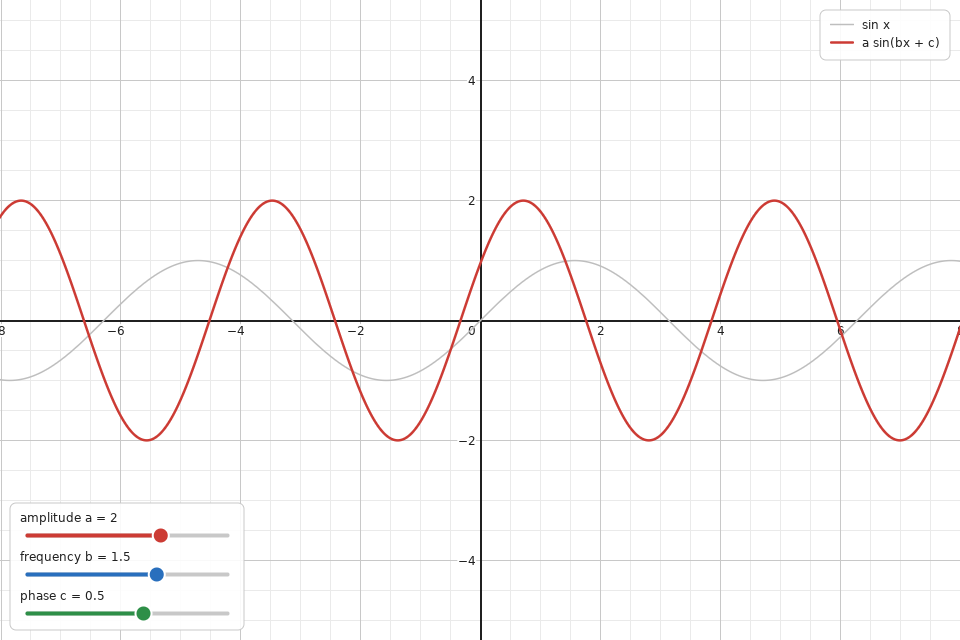
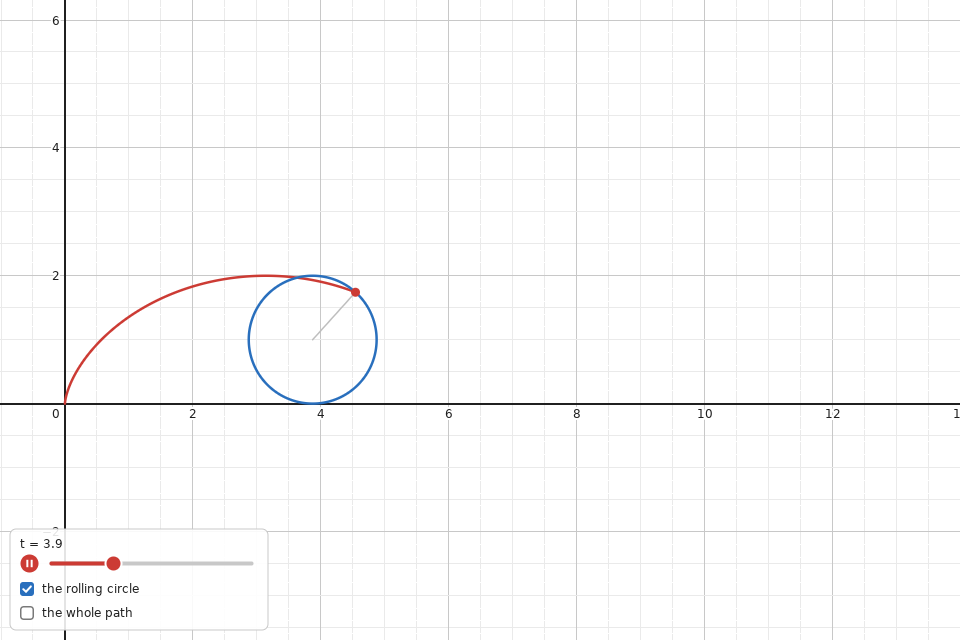
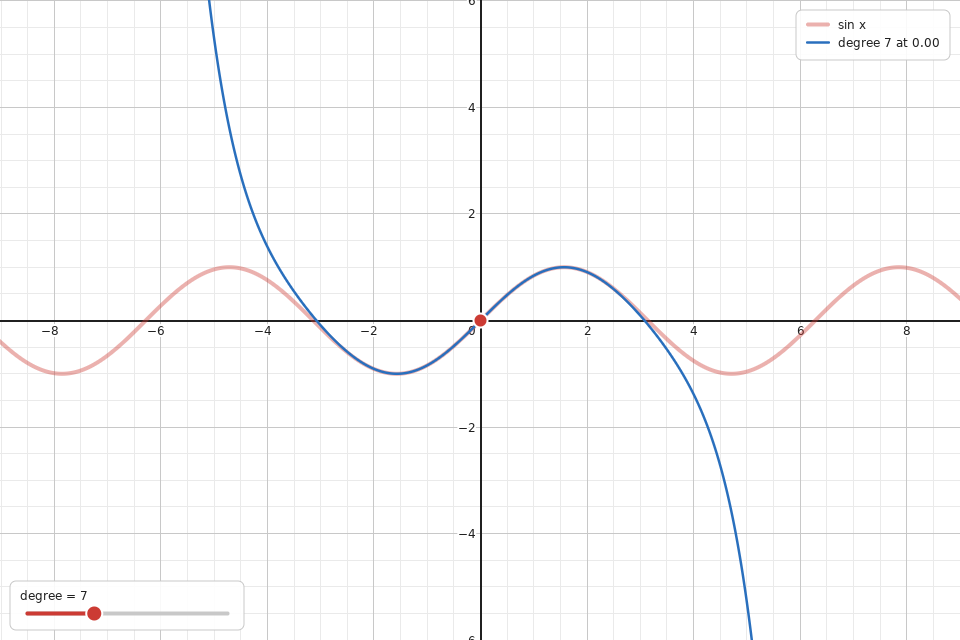

# Draggable points, sliders and checkboxes

Draggable points are points the user moves with the mouse: handles that
reshape a curve, a point that runs round a circle, the bounds of an area.
[Sliders](#sliders) set values that are not positions: an amplitude, a
number of terms; a slider can also [play](#playing-a-slider), sweeping its
value by itself. [Checkboxes](#checkboxes) are switches: show the
derivative, shade the area. They are the things on a plane that keep state
between frames, so they work a little differently from the plotting
methods. You **create** each one once, before the main loop; the plane
**drags** or **toggles** it in `handle_event`; your code **reads** its
position or value every frame and uses it like any number; and you
**draw** them, usually last, with `draw_controls`.

```python
a = grid.draggable((1, 2))                                  # free
s = grid.draggable((-3, 0.5), lock="x", y_range=(0, 1))     # slides up and down
c = grid.draggable(curve=(np.cos, np.sin, (0, 2 * np.pi)))  # on the unit circle

running = True
while running:
    for event in pygame.event.get():
        if event.type == pygame.QUIT:
            running = False
        grid.handle_event(event)        # drags a point under the cursor, else pans

    grid.draw(screen)
    grid.plot(screen, lambda x: s.y * np.sin(x - a.x) + a.y)
    grid.polyline(screen, [(0, 0), c.position])
    grid.draw_controls(screen)
    pygame.display.flip()
```

A press on a point drags the point; anywhere else it pans the plane as
usual, and zooming works in the middle of a drag (the point stays under the
cursor). The point keeps the offset at which you grabbed it, so it never
jumps, and it cannot be dragged out of the plane.

## Sliders



*Three sliders shaping a wave; one is geometric ([`examples/sliders.py`](../../examples/sliders.py))*

```py
grid.slider(label, value_range, *, value=None, step=None, log=False,
             color=None, corner="bottom-left", enabled=True,
             play=None, duration=5.0)
```

```python
amplitude = grid.slider("a", (0, 3), value=1.5)             # before the loop
terms = grid.slider("n", (1, 20), value=5, step=1)          # whole numbers
rate = grid.slider("r", (0.01, 100), value=1, log=True)     # a geometric track

grid.plot(screen, lambda x: amplitude.value * np.sin(x))
grid.plot(screen, pgp.taylor(np.cos, 0, terms.value))       # terms.value is an int
grid.draw_controls(screen)                                  # points, sliders, checkboxes
```

A slider is a value the user sets by dragging a handle along a track. It
is drawn in a panel in a corner of the plane, with its label and value
(`a = 1.5`), and stays where it is while the plane is panned and zoomed:
use one for anything that is not a position in the plane. Press the track
to move the handle there, drag the handle (grabbing it never makes it
jump), or turn the mouse wheel over the slider to move it a step. A press
on a panel never pans the plane, and the wheel over a panel never zooms
it; sliders are above draggable points, which cannot be grabbed through a
panel.

Read the value every frame from `slider.value`, or set it from code.

| Parameter | Default | Meaning |
|---|---|---|
| `label` | | The name shown before the value (`""` for the value alone). |
| `value_range` | | `(low, high)`, the values at the ends of the track. |
| `value` | `low` | The starting value. |
| `step` | `None` | The spacing of the allowed values, counted from `low`. An `int` (`step=1`) makes an integer slider, whose `value` is an `int`. |
| `log` | `False` | Make the track geometric, for values over several powers of ten (`low` must be positive). |
| `color` | a palette colour | The handle and the filled part of the track; each slider (and checkbox) takes the next palette colour, in creation order. |
| `corner` | `"bottom-left"` | `"bottom-left"`, `"bottom-right"`, `"top-left"` or `"top-right"`: which corner's panel the slider is in. |
| `enabled` | `True` | A disabled slider is drawn faded and cannot be moved or played. |
| `play` | `None` | `"loop"`, `"bounce"` or `"once"` gives the slider a [play button](#playing-a-slider), and says what playing does at the end of the track. |
| `duration` | `5.0` | How many seconds playing takes to sweep the whole track. |

Values are exact. With a step, the value is `low + k · step`, computed in
decimal, so a step of 0.1 gives `0.3`, never `0.30000000000000004`, and an
integer slider gives `int`s, ready for `range`, `pgp.taylor` or
`pgp.fourier`. Without a step, a dragged value is rounded to what one
pixel of the track can set (`1.25` rather than `1.2481203`), and shown
that way. A value set from code is kept within the range and on the step.
On a log slider, equal distances along the track multiply the value by
equal factors; with `step=1` it gives whole numbers spread evenly over
the powers of ten, as `n` from 1 to 1000.

```python
terms.value = 8           # moves the handle
if amplitude.moved:       # changed since the previous frame
    print(f"a is now {amplitude.value}")
```

| Attribute | Meaning |
|---|---|
| `value` | The value (an `int` for an integer slider). Assign to move the handle. |
| `moved` | Whether the value changed since the previous frame (stable while you draw). |
| `playing` | Whether it is playing. Assign to start or stop it. |
| `dragging`, `hovered`, `play_hovered` | Whether the slider is being dragged, or the cursor is over its track or its play button. |
| `label`, `color`, `corner`, `enabled`, `play`, `duration` | As created; assign to change them (`play = None` removes the button). |
| `value_range`, `step`, `log`, `integer` | As created (read only). |

Sliders and checkboxes in the same corner are stacked in the order they
are drawn, which is the order they were created unless you pass them to
`draw_controls` yourself. Only the sliders drawn in a frame can be
dragged until the next one, so leaving a slider out of `draw_controls`
hides it and switches it off: a program with several scenes simply draws
each scene's sliders, `grid.draw_controls(screen, *scene_sliders)`.
`slider.remove()` takes a slider off the plane for good, and
`grid.sliders` lists the plane's sliders. A [legend](shapes-and-text.md#legends)
in the same corner as sliders goes beyond their panel, so the sliders stay
where they are.

The panel takes its colours from the theme (its background, the major
grid line colour for the border and the tracks, the label font and
colour), so it suits light and dark themes alike.

### Playing a slider



*A slider that plays rolls a circle along; checkboxes show its parts ([`examples/controls.py`](../../examples/controls.py))*

```python
t = grid.slider("t", (0, 2 * np.pi), play="loop", duration=4)       # a play button
n = grid.slider("n", (1, 12), step=1, play="bounce", duration=6)
t.playing = True                                                    # playing from the start

grid.plot(screen, lambda x: np.sin(x - t.value))
grid.draw_controls(screen)
```

A slider made with `play=` has a play button left of its track, as in
Desmos. Pressed, the handle sweeps along the track by itself, one sweep
taking `duration` seconds, until the button is pressed again; set
`slider.playing` to start or stop it from code. `play` says what happens
at the end of the track:

| `play` | At the end of the track |
|---|---|
| `"loop"` | Starts again from the low end. |
| `"bounce"` | Turns round, and sweeps back and forth between the ends. |
| `"once"` | Stops (pressing play there starts again from the low end). |

A playing slider is an ordinary slider whose value changes by itself:
your code reads `value` as usual, `moved` is true in each frame it moved,
and dragging the handle holds it where you drag it, playing on from
there when you let go. The sweep is even along the track (geometric on a
log slider). A stepped slider goes from step to step, each value shown for
the same time (an integer slider from 1 to 5 shows each number for a fifth
of the sweep), and one without a step moves smoothly: its value is not
rounded to a pixel of the track while it plays.

Playing sliders move on when each frame starts (in `grid.draw`), by the
time since the previous frame from pygame's clock
(`pygame.time.get_ticks`), so they keep time whatever the frame rate; a
stalled frame moves them by a quarter of a second at most, so they never
jump. They need frames to move, as eased zooming does, and they play
whether or not they are drawn. In a panel with play buttons, the tracks of
the sliders without one start further left, so every track ends at the
same place.

## Checkboxes

```py
grid.checkbox(label, *, value=False, color=None, corner="bottom-left",
               enabled=True)
```

```python
show = grid.checkbox("show the derivative")                 # before the loop
shade = grid.checkbox("shade the area", value=True)

f = lambda x: x**3 / 6 - x
if shade.value:
    grid.fill_between(screen, f, 0)
grid.plot(screen, f)
if show.value:
    grid.plot(screen, pgp.derivative(f))
grid.draw_controls(screen)                                  # with the sliders
```

A checkbox is a switch, drawn as a box with its label beside it, in the
same corner panels as sliders (stacked with them in creation order). A
click on the box or on its label ticks or unticks it; your code reads
`value`, `True` or `False`, every frame, and draws or computes something
accordingly. Like a slider, it stays where it is while the plane is
panned and zoomed, a press on it never pans the plane, and leaving it out
of `draw_controls` hides it and switches it off.

| Parameter | Default | Meaning |
|---|---|---|
| `label` | | The text beside the box. |
| `value` | `False` | Whether it starts ticked. |
| `color` | a palette colour | The ticked box's colour; each checkbox (and slider) takes the next palette colour, in creation order. Pass a plot's colour to match the plot it shows. |
| `corner` | `"bottom-left"` | Which corner's panel it is in. |
| `enabled` | `True` | A disabled checkbox is drawn faded and cannot be clicked. |

| Attribute | Meaning |
|---|---|
| `value` | `True` when ticked. Assign to tick or untick it. |
| `changed` | Whether the value changed since the previous frame (stable while you draw), like a slider's `moved`. |
| `hovered` | Whether the cursor is over it. |
| `label`, `color`, `corner`, `enabled` | As created; assign to change them. |

`checkbox.remove()` takes it off the plane, and `grid.checkboxes` lists
the plane's checkboxes.

## Four kinds of point



*A point locked to the x axis moves the centre of a Taylor polynomial ([`examples/taylor.py`](../../examples/taylor.py))*

| Kind | Created with | Moves |
|---|---|---|
| Free | `grid.draggable((x, y))` | Anywhere. |
| x locked | `grid.draggable((x, y), lock="x")` | Up and down only: x stays fixed. |
| y locked | `grid.draggable((x, y), lock="y")` | Left and right only: y stays fixed. |
| On a curve | `grid.draggable(curve=(x, y, t_range))` | Along the parametric curve `(x(t), y(t))`. |

A point on a curve takes the curve's components exactly as
[`parametric`](curves.md#parametric-curves) does: functions of `t`
(NumPy or plain `math`) or numbers. It starts at `t` (default: the start of
`t_range`), or at the point of the curve nearest a `position` you give:

```python
on_circle = grid.draggable(curve=(np.cos, np.sin, (0, 2 * np.pi)), t=np.pi / 4)
on_parabola = grid.draggable(curve=(lambda t: t, lambda t: t**2, (-3, 3)),
                              position=(1, 1))
on_spiral = grid.draggable(curve=(lambda t: 0.2 * t * np.cos(t),
                                   lambda t: 0.2 * t * np.sin(t), (0, 6 * np.pi)))
```

How a point follows the cursor depends on the curve, as it looks on
screen:

- **On a graph**, a curve that runs steadily from left to right (or right
  to left) such as `(t, f(t))` or a cycloid, every x has one point, and the
  dragged point is the one at the cursor's x. It stays level with the
  cursor however far above or below the curve the cursor is, moves exactly
  as the cursor moves sideways, passes straight through jumps (`floor`)
  and asymptotes (`tan`), and waits at a domain edge (`sqrt` at 0) while
  the cursor is beyond it. A curve that runs steadily up or down instead,
  such as the sideways parabola `(t**2, t)`, follows the cursor's y.
- **On any other curve** (a circle, a spiral, a figure-eight), the point
  follows the curve from where it is to the point nearest the cursor, so
  it passes through crossings (a figure-eight, a spirograph) and between
  the turns of a spiral without jumping. It jumps to another part of the
  curve only when that part is clearly closer to the cursor (by about 10
  pixels), so it can still be pulled straight across to another branch. On
  a closed curve such as a circle, dragging past the end continues from
  the start.

Placing a point from code (`position=`) always takes the nearest point of
the curve. The point's `t` tells you where on the curve it is: on the
circle above, it is the angle.

## Reading and setting the position

| Attribute | Meaning |
|---|---|
| `x`, `y`, `position` | The world position. |
| `t` | The curve parameter of a point on a curve (`None` for other points). |
| `dragging`, `hovered` | Whether the point is being dragged, or under the cursor. |
| `moved` | Whether the point moved since the previous frame (stable while you draw). |

Assigning `position` moves a point from code: a free point goes there, a
locked point too (locks restrict only dragging), and a point on a curve goes
to the nearest point of its curve. Assigning `t` moves a point along its
curve.

```python
a.position = (0.5, 1.5)
on_circle.t = np.pi           # to (-1, 0)
if a.moved:
    print(f"a is now at ({a.x:.3g}, {a.y:.3g})")
```

Use `moved` to recompute something expensive only when a point has
changed. A frame starts at `grid.draw`, so `moved` keeps its value while
you draw.

## Bounds

`x_range` and `y_range` keep free and locked points within limits, while
dragging and when set from code. A point on a curve is kept within its
`t_range` instead.

```python
amplitude = grid.draggable((-6, 1), lock="x", y_range=(0.1, 3))
grid.polyline(screen, [(-6, 0.1), (-6, 3)], width=4, opacity=0.3)  # a track
```

On a [log axis](log-axes.md) a point can never be dragged to zero or below.

## How points look

Draggable points are larger than plain [points](data.md#points), with
an outline in the theme's background colour that separates them from the
curves they sit on. Each takes its own palette colour, in the order the
points were created (so colours do not change with what else you draw).
Change any of it when creating the point, or later through its attributes:

```python
handle = grid.draggable((2, 1), color="crimson",
                         style=pgp.PointStyle(radius=8, marker="square"))
handle.color = (40, 120, 200)
```

While the cursor is over a point (or the point is dragged) it gets a
translucent ring, the cursor becomes a hand, and the point's coordinates
appear next to it, rounded to the size of a pixel: `(1.23, -0.5)` at the
default zoom, `(1.2346, -0.5)` zoomed in a hundred times. `coordinates=`
chooses when they show: `"hover"` (the default), `"always"` or `"never"`.
The label uses the theme's number format and label font.

`draw_controls(screen)` draws every point of the plane; pass some points
to draw only those (`grid.draw_controls(screen, a, c)`). Draw them after
the plots so they sit on top.

## Turning points off and removing them

`point.enabled = False` keeps a point visible but stops it being dragged.
`point.remove()` takes it off the plane for good. `grid.draggables` lists
the plane's points, and `grid.dragged` is the one being dragged, if any.

`grid.interactive = False` switches off only panning and zooming:
draggable points still work, which suits a fixed view with handles on it.

## Settings

Three fields of [`InteractionConfig`](interaction.md#configuring-the-controls)
control dragging:

| Field | Default | Meaning |
|---|---|---|
| `drag_button` | `1` | Mouse button that drags points. |
| `grab_margin_px` | `6.0` | A point can be grabbed this many pixels beyond its marker. |
| `hover_cursor` | `True` | Show the hand cursor over points, sliders and checkboxes. |

## Animated curves

A point on a curve can follow a curve that changes from frame to frame:
assign the new curve to `point.curve` each frame, and the point keeps its
parameter `t`:

```python
t_now = pygame.time.get_ticks() / 1000
radius = 2 + np.sin(t_now)
on_circle.curve = (lambda t: radius * np.cos(t), lambda t: radius * np.sin(t),
                   (0, 2 * np.pi))
```

## Limits

- Points and sliders are moved with the mouse only (and the wheel, for
  sliders); there is no keyboard focus or nudging yet, and points cannot
  snap to a step.
- Sliders are always in a corner of the plane, inside it: a program that
  wants controls elsewhere (a sidebar) draws its own.
- A point on a curve follows the curve as it is drawn, sampled finely on
  screen; on a part of the curve that is far off screen it follows a coarser
  version until that part comes into view.

See [`examples/geometry.py`](../../examples/geometry.py) for free points (the corners
of a triangle), [`examples/taylor.py`](../../examples/taylor.py) for a point locked to
the x axis, [`examples/calculus.py`](../../examples/calculus.py) for a point on a
curve, and [`examples/sliders.py`](../../examples/sliders.py) for sliders.
