# Examples

Every program in the repository's `examples/` folder, with what it shows.
Each is one short file using only `import pygridplot as pgp`, written
the way your own program would be: copy one to start from. To run them,
clone or download the repository, `pip install pygridplot`, and run
`python examples/calculus.py`, say. In every one you can drag to pan,
scroll to zoom and press Home to go back to the start.

<!-- Generated by scripts/render_examples.py from the examples'
     docstrings and pictures: edit those, then run it again. -->

## Getting started

### Quick start

A plane you can pan and zoom, with a few plots on it.

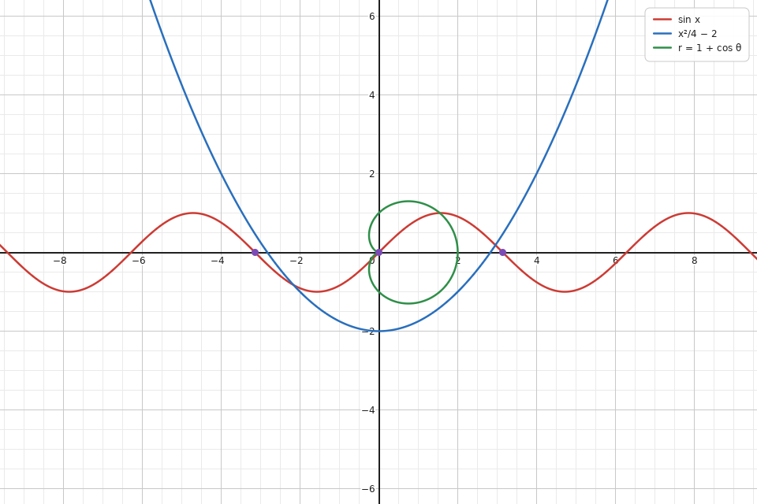

Drag to pan, scroll to zoom about the cursor, and press Home to go back to
the start. Every frame draws the grid first, then the plots on top of it.

`python examples/quickstart.py` ([source](../../examples/quickstart.py))

### Quick look

Plot a few functions without writing a loop.

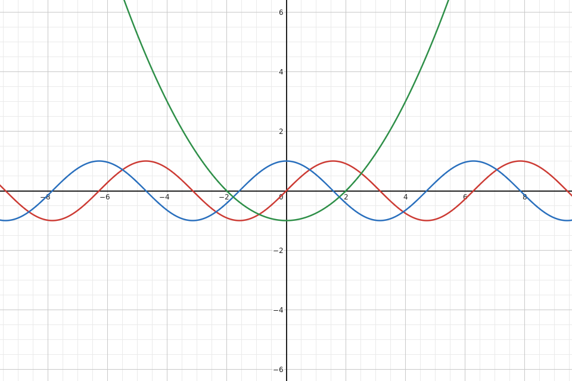

`pgp.show` opens a window, plots the functions and returns when the
window is closed (or Escape is pressed). Drag to pan, scroll to zoom.

`python examples/quick_look.py` ([source](../../examples/quick_look.py))

## Functions and calculus

### Functions

Plotting y = f(x), awkward functions included.

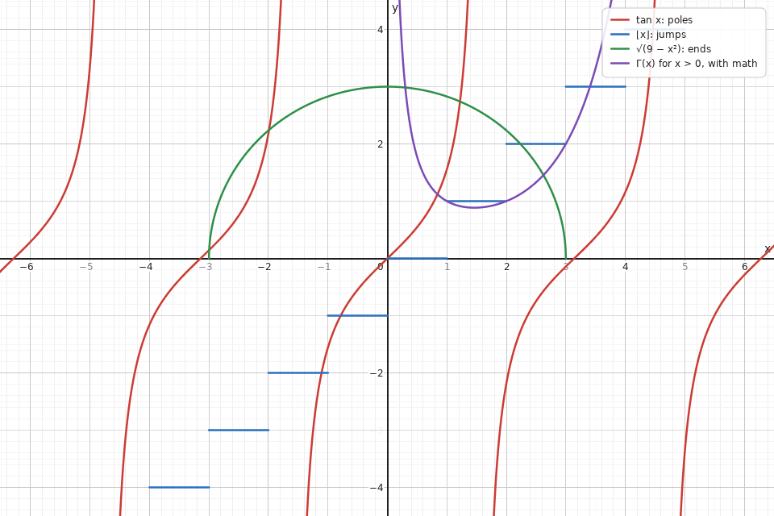

Poles, jumps, square roots that stop and functions written with `math`
for single numbers all plot correctly: asymptotes are not joined up,
steps stay steps, and curves end exactly where they stop being defined.
Zoom in on the ends and the jumps to see. `domain=` limits a function
to part of the x axis.

`python examples/functions.py` ([source](../../examples/functions.py))

### Calculus

A tangent line and the area under a curve.

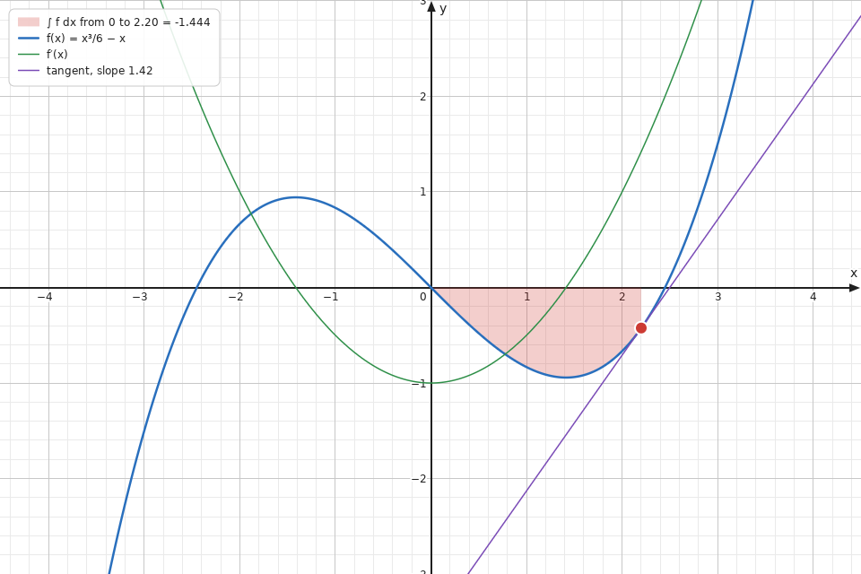

Drag the point along the curve. The tangent comes from the exact
derivative, `pgp.derivative(f)`, and the shaded area and its value from
`pgp.integral(f, 0, x)`. The derivative is drawn too.

`python examples/calculus.py` ([source](../../examples/calculus.py))

### Line styles

Dashed asymptotes and a dashed tangent, with dotted guides.

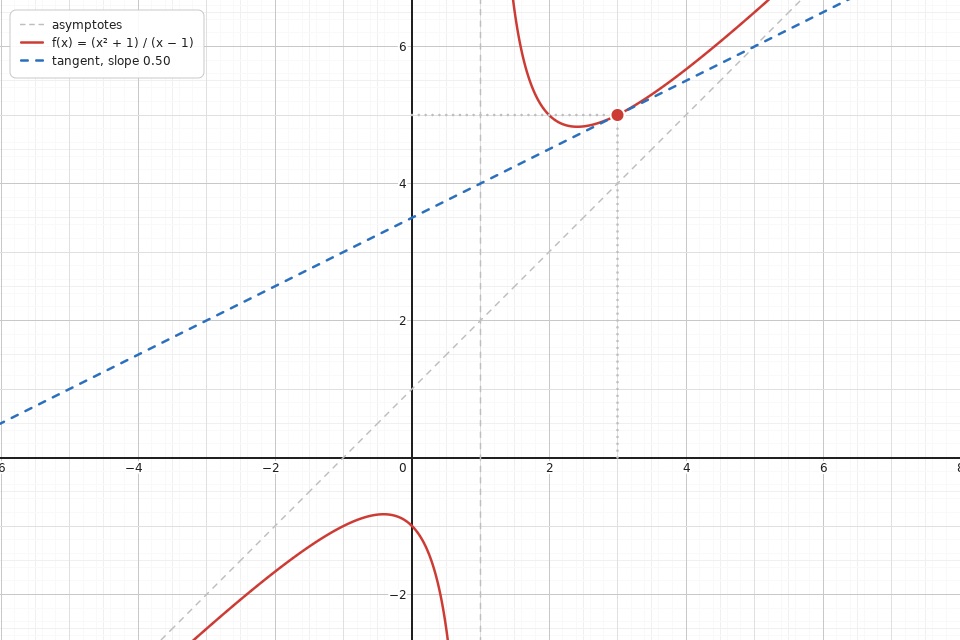

Drag the point along the curve. Its tangent is dashed, and dotted lines
drop from it to the axes; the curve's two asymptotes are dashed too. Pan
the plane: the dashes are fixed to it, so they move with the lines.

`python examples/line_styles.py` ([source](../../examples/line_styles.py))

### Taylor polynomials

Approximating sin x.

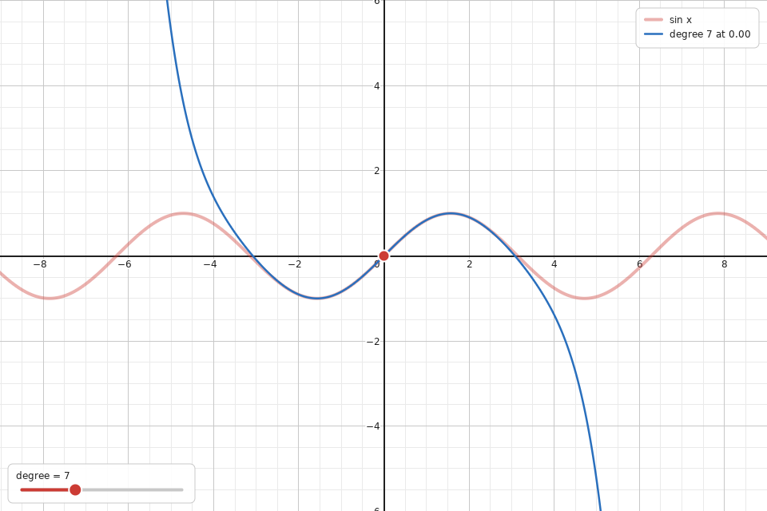

`pgp.taylor(f, a, n)` is the Taylor polynomial of degree `n` at `a`,
built from exact derivatives. Choose the degree with the slider, and drag
the point along the x axis to move the centre: the polynomial hugs the
curve near it and leaves it further away.

`python examples/taylor.py` ([source](../../examples/taylor.py))

### Fourier series

Adding up a square wave.

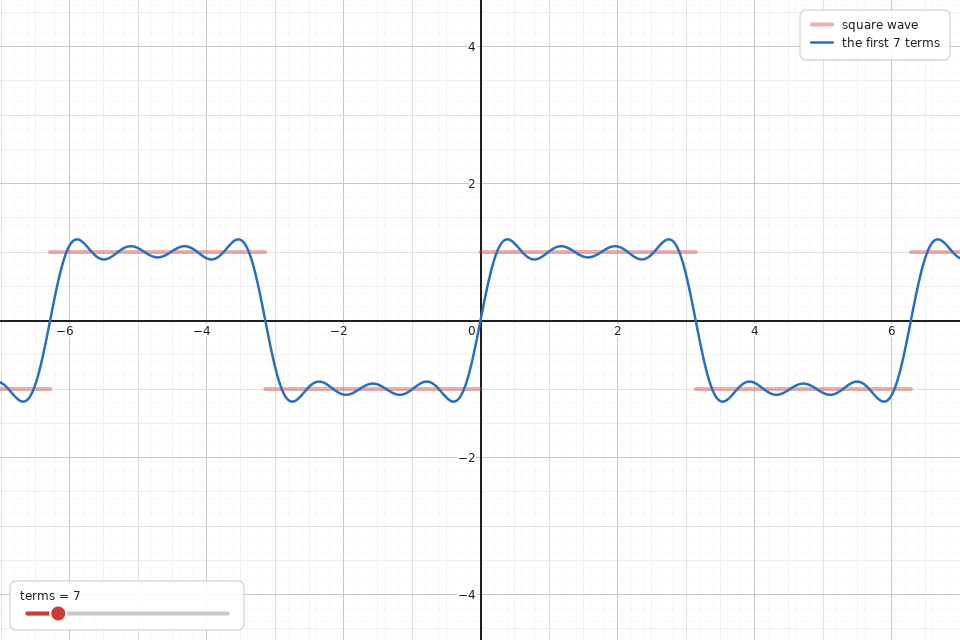

`pgp.fourier(f, n)` is the sum of the first `n` harmonics of `f`,
over one period (2π unless you give another). Add terms with the slider:
the sum closes in on the square wave, except for the overshoot beside each
jump (Gibbs' phenomenon), which narrows but never shrinks.

`python examples/fourier.py` ([source](../../examples/fourier.py))

## Curves and regions

### Curves

Parametric and polar curves, on the dark theme.

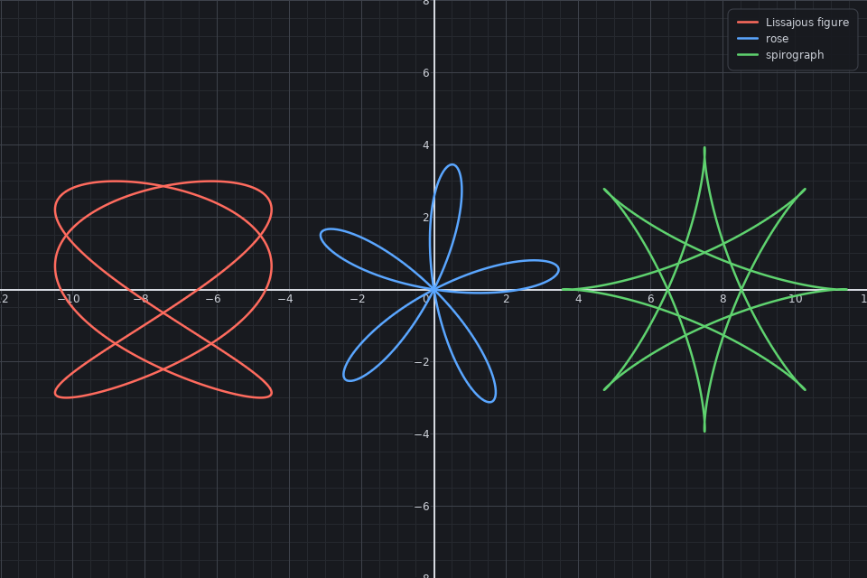

`parametric(x, y, t_range)` draws the points `(x(t), y(t))`, and
`polar(r)` draws `r(θ)` around the origin. Both sample more where the
curve bends, so loops and cusps stay smooth at any zoom. Each curve moves
with the time `t`: plots are redrawn from scratch every frame, so
animation needs nothing special.

`python examples/curves.py` ([source](../../examples/curves.py))

### Implicit curves

The contour lines of a landscape.

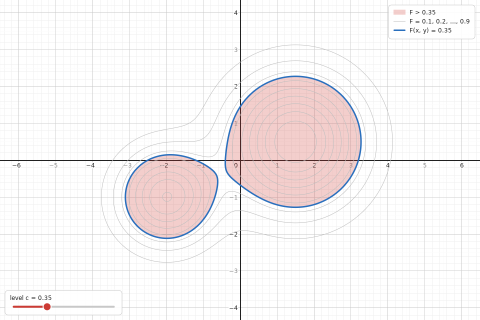

`implicit(F, c)` draws the curve where `F(x, y) = c`, however many
loops and pieces it has. Given several values of `c` it draws a contour
map. Choose a level with the slider: its curve is drawn in bold, and the
region above it is shaded with `inequality`.

`python examples/implicit.py` ([source](../../examples/implicit.py))

### Regions

Inequalities, and the area between two graphs.

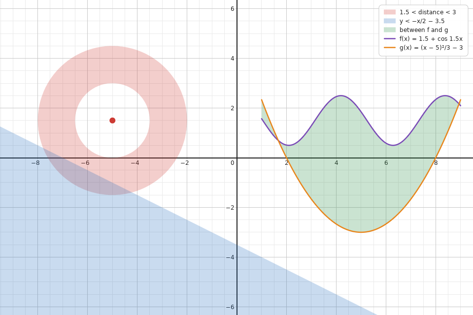

`inequality(condition)` shades the points where a condition holds.
Conditions are plain Python, combined with `&` (and), `|` (or) and
`~` (not); brackets matter, as `&` binds more tightly than `<`. Drag
the point to move the ring. `fill_between(f, g)` shades between two
graphs, and stops cleanly where they cross.

`python examples/regions.py` ([source](../../examples/regions.py))

## Fields

### Vector fields

The electric field of two charges.

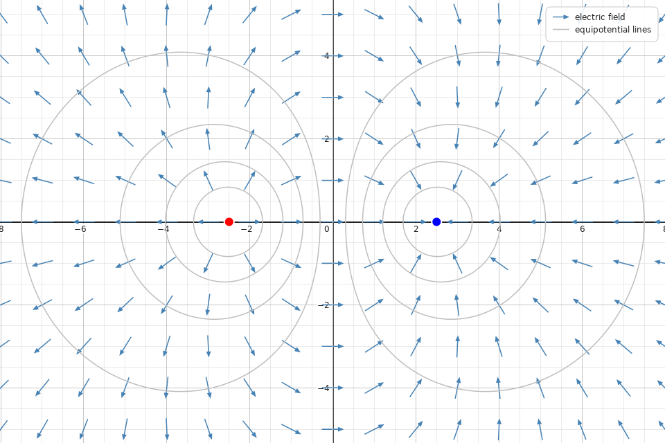

`vector_field(F)` draws an arrow in the direction of `F(x, y)` at the
points of a lattice that stays put while you pan and keeps its density as
you zoom. Drag the two charges: the field, and the equipotential lines
drawn with `implicit`, follow them.

`python examples/fields.py` ([source](../../examples/fields.py))

### Slope fields

The solutions of y′ = x − y.

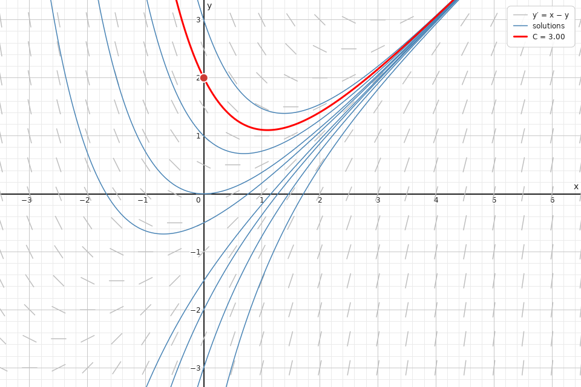

`slope_field(f)` draws a short segment of slope `f(x, y)` at the
points of a lattice: the direction a solution of `y′ = f(x, y)` takes
there. This equation's solutions are `y = x − 1 + C e^(−x)`, one for
each `C`. Drag the point: the solution through it is drawn in bold.

`python examples/slope_field.py` ([source](../../examples/slope_field.py))

## Points, sliders and shapes

### Sliders

Shape a wave with three parameters.

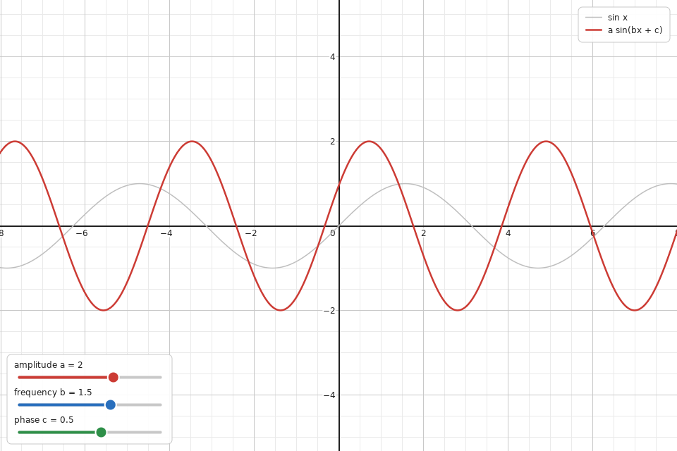

Sliders are created once, before the loop, and read every frame. Drag a
knob, press its track, or scroll over a slider to move it a step. The
frequency slider is geometric (`log=True`): equal distances along it
multiply the value by the same factor.

`python examples/sliders.py` ([source](../../examples/sliders.py))

### Controls

A rolling circle driven by a slider that plays, and checkboxes.

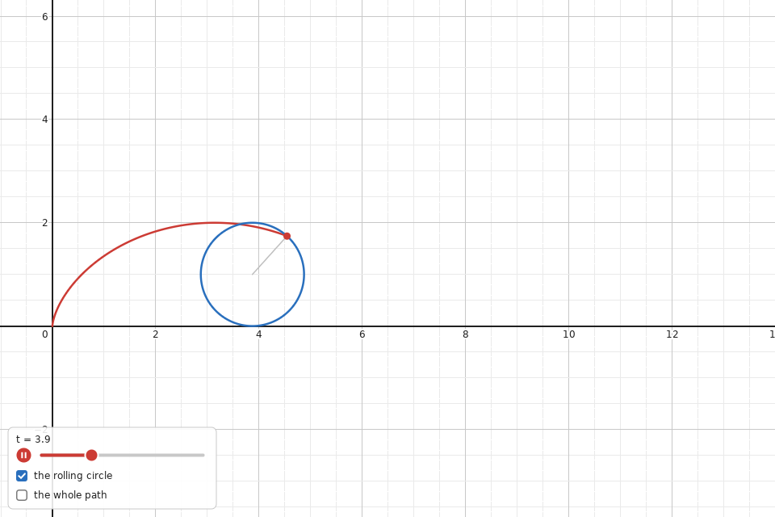

The slider `t` plays by itself, in a loop: press its play button to stop
and start it, or drag it. As the circle rolls along the x axis, a point on
its rim traces a cycloid. The checkboxes show or hide the circle and the
whole path; your code reads their `value` every frame.

`python examples/controls.py` ([source](../../examples/controls.py))

### Geometry

A triangle you can reshape, and its circumcircle.

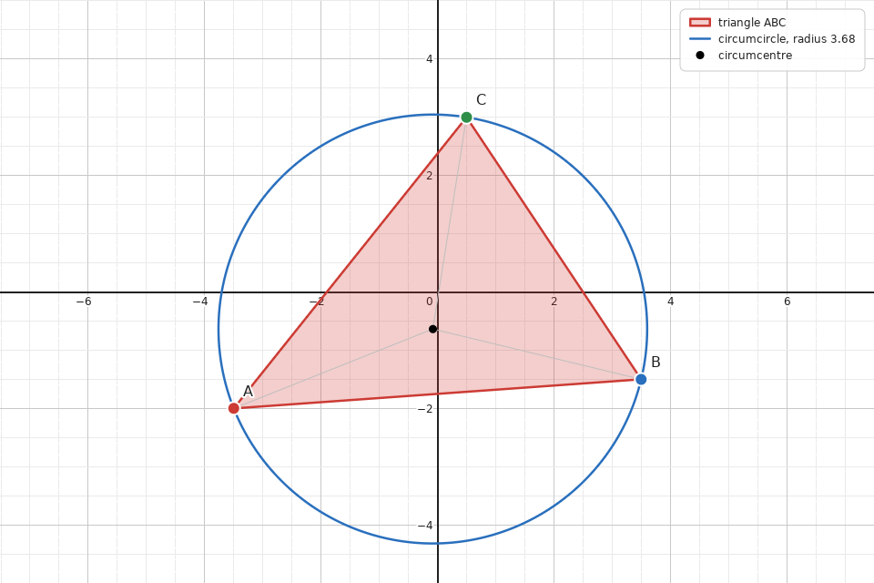

Drag the corners. Every frame works out, from where the corners are, the
circumcentre (the point equally far from all three) and the circle
through them, and draws them with `polygon`, `parametric`,
`polyline`, `points` and `text`.

`python examples/geometry.py` ([source](../../examples/geometry.py))

### Sequences

The terms of a sequence, and its partial sums.

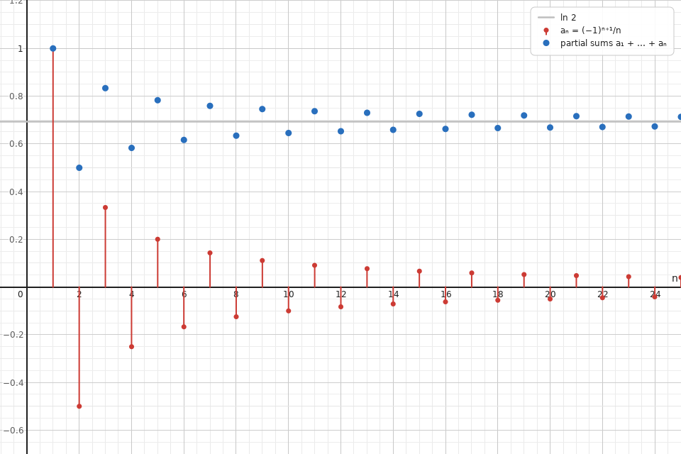

`sequence(terms)` draws the terms `aₙ` as stems, where `terms` is a
function of `n` (or a list of values). The alternating harmonic series
1 − 1/2 + 1/3 − … converges to ln 2: its partial sums, drawn as points,
close in on it from either side. Zoom out to see further along.

`python examples/sequences.py` ([source](../../examples/sequences.py))

## Data

### Scatter plots

Colour by a third value, and a fitted line.

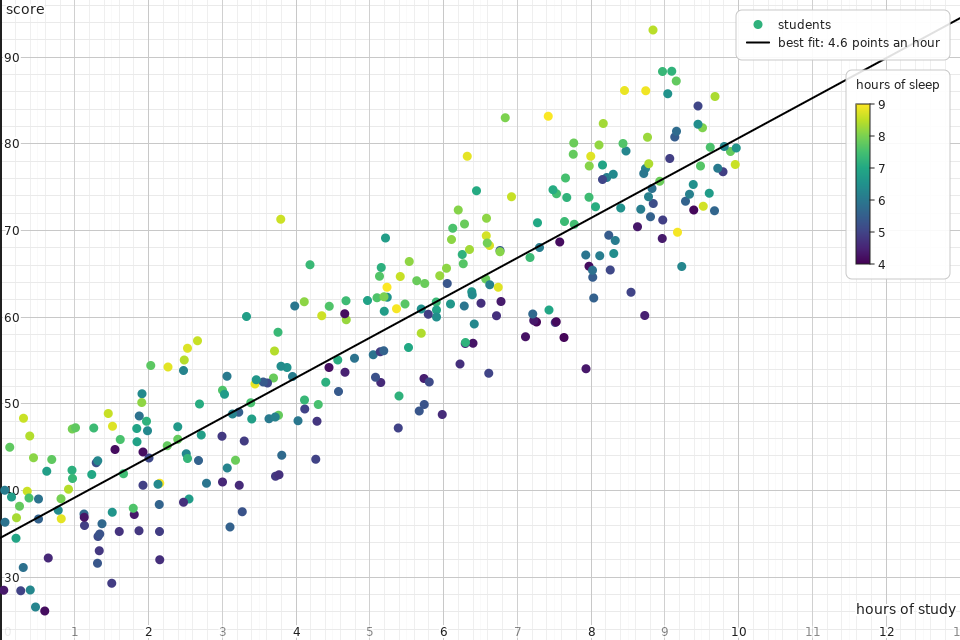

`points` takes a colour for each point: `pgp.color_map` turns values
into colours, and `color_bar` shows which colour is which value.
`pgp.data_range` gives the y axis a range that shows all the data; the x
axis leaves room on the right for the legend and the colour bar.

`python examples/scatter.py` ([source](../../examples/scatter.py))

### Histograms

Filling up as samples arrive.

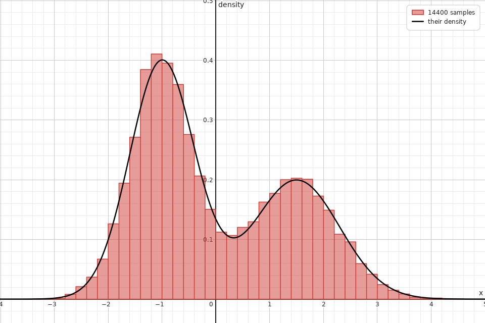

Each frame adds 40 samples. `histogram(samples, density=True)` counts
them in bins anchored at multiples of the bin width, so the bins never
shift as samples arrive, and it picks the width itself: narrower as the
samples pile up. The curve is the density they are drawn from.

`python examples/histogram.py` ([source](../../examples/histogram.py))

### Bar charts

Stacked bars, named categories and error bars.

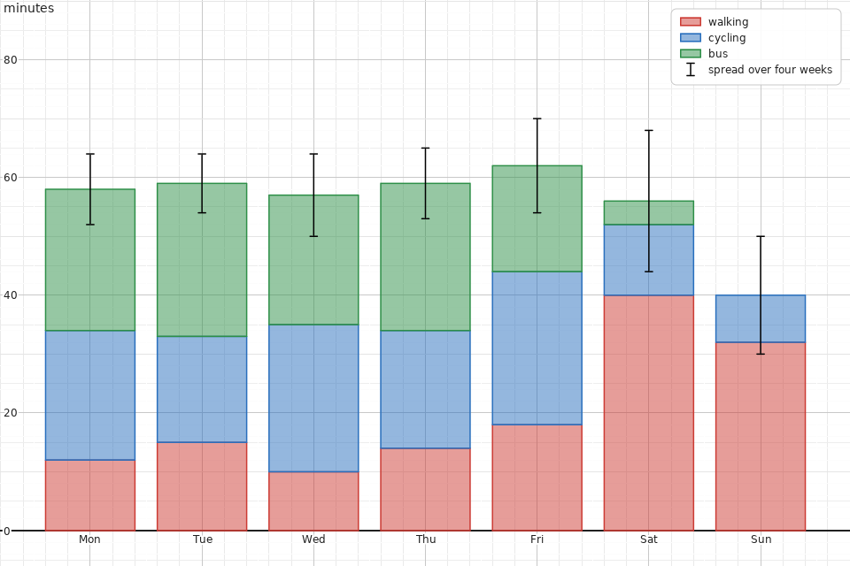

Each bar stands on a baseline, so stacking is drawing each layer on top
of the totals so far. The bars stand at 1, 2, 3, ... (`start=1`), and
`draw(x_labels=...)` names those positions; `points(..., y_error=...)`
with `radius=0` draws error bars alone.

`python examples/bars.py` ([source](../../examples/bars.py))

### Box and violin plots

Comparing groups of samples.

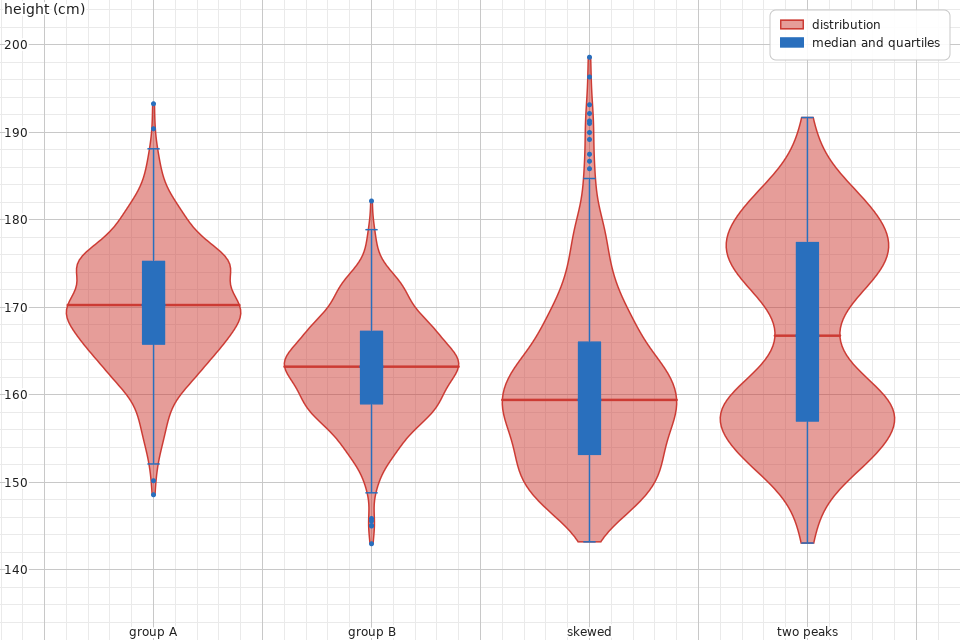

A violin shows how a group's values are spread (a smoothed density,
mirrored), and a box plot its median, quartiles, whiskers and outliers.
Here a narrow box sits inside each violin. Each call takes a list of
groups, drawn at 1, 2, 3, ... (`start=1`), which `draw(x_labels=...)`
names.

`python examples/distributions.py` ([source](../../examples/distributions.py))

## Axes

### Logarithmic axes

Power laws are straight lines.

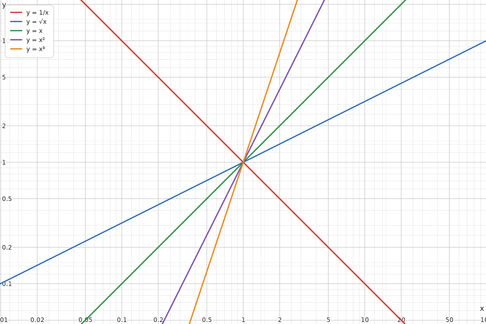

On log-log axes `y = xᵏ` is a straight line of slope `k`, and every
decade is the same size (given only the x range, the plane keeps both
axes' decades equal). Zoom out and the decades thin out; zoom into one
decade and its subdivisions fade in until it looks linear.

`python examples/log_axes.py` ([source](../../examples/log_axes.py))

## Animation, games and recording

### Animation

A rolling wheel draws a cycloid.

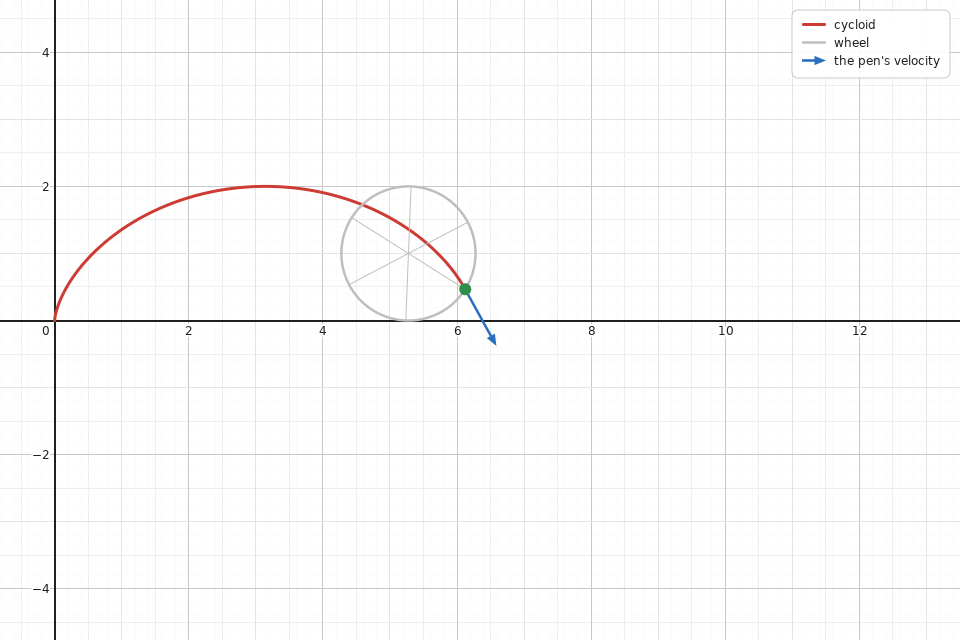

Nothing is created, moved or deleted: every frame draws the wheel, the
pen's velocity and the curve traced so far from the time alone. That is
all animation takes, and you can still pan and zoom while it runs.

`python examples/animation.py` ([source](../../examples/animation.py))

### A plane inside a game

A bouncing ball, and a live graph of its height.

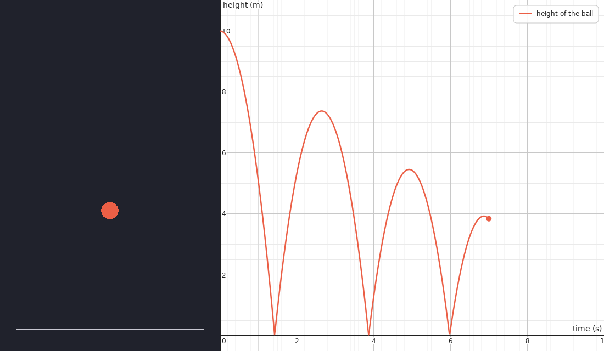

The left of the window is ordinary pygame drawing. The right is a
`Grid` given a rectangle of the window, plotting the ball's height as
it falls and bounces; `set_view` keeps the last ten seconds in view.

`python examples/embedded.py` ([source](../../examples/embedded.py))

### Recording

Press S to save a picture, and R to start and stop a video.

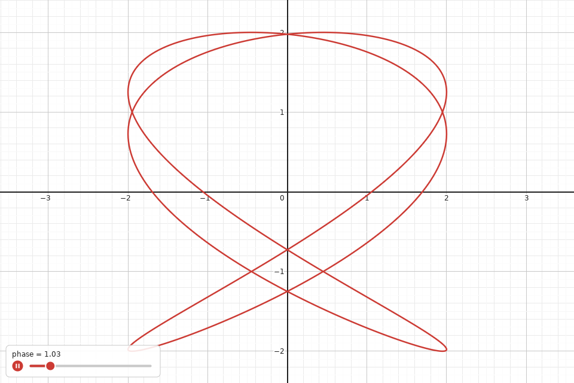

A Lissajous figure turns as its phase plays. S saves the plane as a PNG
at twice the size (`grid.save`); R starts recording a video of it, and R
again finishes it (`pgp.Recorder`, which needs ffmpeg: see the user
guide's page on saving pictures and videos). The files go in the folder the
program runs from.

`python examples/recording.py` ([source](../../examples/recording.py))
