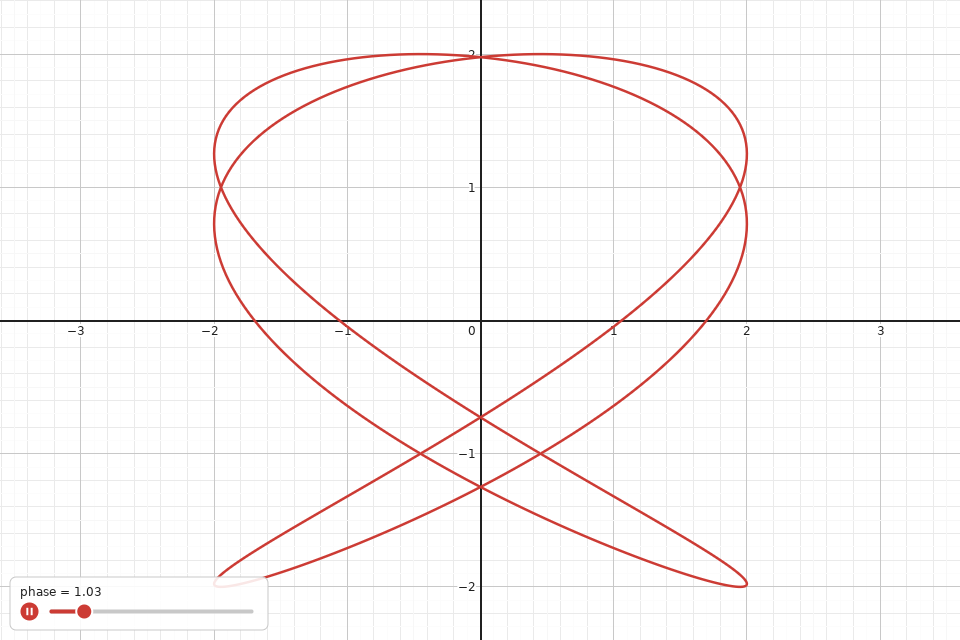

# Saving pictures and videos

A plane can save what it drew as a picture, at the resolution you like,
and record a video of itself frame by frame: a quick, small draft while you
work on an animation, and a sharp one at the end, from the same program.



*The recording example: a Lissajous figure turning as its phase plays ([`examples/recording.py`](../../examples/recording.py))*

- [Saving a picture](#saving-a-picture)
- [Recording a video](#recording-a-video)
- [Setting up ffmpeg](#setting-up-ffmpeg)
- [Recording numbered pictures](#recording-numbered-pictures)
- [Time in a recording](#time-in-a-recording)
- [Recording without a window](#recording-without-a-window)
- [Troubleshooting](#troubleshooting)
- [Limits](#limits)

## Saving a picture

```py
grid.save(path, *, scale=1.0)
```

Call it after drawing a frame (the grid, the plots, the controls), before
the next `grid.draw`:

```python
grid.draw(screen)
grid.plot(screen, np.sin, label="sin x")
grid.legend(screen)
grid.save("sine.png")                   # exactly as on screen
grid.save("sine@3x.png", scale=3)       # three times as wide and as tall
grid.save("thumbnail.jpg", scale=0.25)  # a small preview
```

The picture is the plane alone: its rectangle, with everything the plane
drew in this frame, and nothing outside it. At `scale=1` it is the
screen's pixels exactly (to a level, for a plane in part of the window). At
other scales the plane draws the frame again onto a picture `scale` times
as wide and as tall, with every line, point, label and panel `scale` times
the size: the same picture, sharper (or, below 1, smaller). That is what
`scale` is for: `2` to `4` for slides, posters and print.

| Argument | Default | Meaning |
|---|---|---|
| `path` | | Where to save. The extension is the file type: `.png` (lossless, the best choice), `.jpg`, `.bmp` or `.tga`. Missing folders are created. |
| `scale` | `1.0` | How many times as many pixels along each side, up to 16384 pixels a side. |

A plane whose theme has no background (`background=None`, see
[Styles and themes](styles-and-themes.md#themes)) saves a PNG that is
transparent wherever nothing is drawn, ready to lay over something else in
a slide or a document; JPEG pictures have no transparency, so they get the
plane's label halo colour behind them.

Only what the *plane* drew is in the picture. To save the whole window,
with your own pygame drawing (captions, buttons, a sidebar), use pygame:
`pygame.image.save(screen, "window.png")`.

## Recording a video

```py
pgp.Recorder(path, *, fps=60.0, scale=1.0, ffmpeg=None)
```

A `Recorder` is given each frame as it is drawn, and closed at the end;
a `with` block closes it however the block ends (an error, the window
closed), so the video is always finished:

```py
t = grid.slider("t", (0, 2 * np.pi), play="loop", duration=4)
t.playing = True

with pgp.Recorder("wave.mp4", fps=60) as video:
    for _ in range(240):                       # four seconds of video
        grid.draw(screen)
        grid.plot(screen, lambda x: np.sin(x - t.value))
        grid.draw_controls(screen)
        video.add(grid)                        # this frame of the plane
        pygame.display.flip()
```

The extension of `path` decides what is written:

| Extension | Video | Notes |
|---|---|---|
| `.mp4` | H.264 | Plays everywhere: browsers, phones, slides (PowerPoint, Keynote, Google Slides). Nearly lossless (constant quality 18). |
| `.webm` | VP9 | For web pages; smaller, slower to encode. |
| `.gif` | GIF | Loops in chat apps and README files; large files, 256 colours a frame. Record at `fps=25` or `30` (GIF times frames in hundredths of a second) and a small `scale`. |
| `.mov`, `.mkv` | H.264 | As `.mp4`, in those containers. |
| `.png`, `.jpg`, ... | none | [Numbered pictures](#recording-numbered-pictures), which need no ffmpeg. |

Any other extension is written by ffmpeg with its own default settings
for it. Videos need [ffmpeg](#setting-up-ffmpeg), a free program that
runs alongside Python; nothing else does.

`video.add(grid)` draws the plane again for each frame at the recorder's
`scale`, as [`grid.save`](#saving-a-picture) does. That is how a draft and
a final version come from one program:

```py
draft = pgp.Recorder("draft.mp4", fps=30, scale=0.5)   # quick and small, to check
final = pgp.Recorder("final.mp4", fps=60, scale=2)     # sharp: twice the window's size
```

To record the whole window instead, with whatever you drew on it, add the
surface: `video.add(screen)`. It is recorded as it is; a `scale` other
than 1 resizes it (blurring it when making it bigger). The first frame
sets the size of the video: frames of another size (after the window is
resized) are scaled to it.

| Argument | Default | Meaning |
|---|---|---|
| `path` | | The file to write; its extension says what (see above). Missing folders are created. |
| `fps` | `60.0` | Frames per second of the video. |
| `scale` | `1.0` | How many times as many pixels along each side the plane is drawn with. |
| `ffmpeg` | found by itself | The ffmpeg program's path, if it is not [found by itself](#setting-up-ffmpeg). |

| Attribute or method | Meaning |
|---|---|
| `add(grid)`, `add(surface)` | Add a frame: the plane as drawn in this frame, or a surface's pixels. |
| `close()` | Finish the file (the `with` block calls it). A recorder given no frames writes nothing. |
| `frames` | How many frames have been added. |
| `time` | The video's time at the next frame, `frames / fps` seconds (see [Time in a recording](#time-in-a-recording)). |
| `path`, `fps`, `scale`, `closed` | As created; whether it is closed. |

Frames go to ffmpeg as they are drawn, so nothing piles up in memory,
however long the recording. Encoding takes time, so a program recording a
large video runs more slowly than usual; the video still plays at the
right speed (see [Time in a recording](#time-in-a-recording)).

The [recording example](../../examples/recording.py) starts and stops a
video with a key, and saves a picture with another.

## Setting up ffmpeg

[ffmpeg](https://ffmpeg.org) is the free program that turns the frames
into a video file. PyGridPlot does not install it (it is not a Python
package); a recorder looks for it, in this order:

1. the path you give: `pgp.Recorder("a.mp4", ffmpeg="C:/tools/ffmpeg/bin/ffmpeg.exe")`;
2. `ffmpeg` on your system's `PATH`, where installing it with a package
   manager puts it;
3. the [`imageio-ffmpeg`](https://pypi.org/project/imageio-ffmpeg/)
   package, which brings a copy of ffmpeg of its own, if it is installed.

So install it either for your system or as a Python package, as below;
the Python package is the simplest, on any system.

**Installing it for your system.** Pick yours, then open a *new* terminal
(so it sees the updated `PATH`):

| System | Command |
|---|---|
| Windows 10 and 11 | `winget install ffmpeg` (or `choco install ffmpeg` with Chocolatey, `scoop install ffmpeg` with Scoop) |
| macOS | `brew install ffmpeg` (with [Homebrew](https://brew.sh)) |
| Debian, Ubuntu, Raspberry Pi OS | `sudo apt install ffmpeg` |
| Fedora | `sudo dnf install ffmpeg` (after enabling [RPM Fusion](https://rpmfusion.org)) |
| Arch | `sudo pacman -S ffmpeg` |

On Windows without a package manager, download a build from
[ffmpeg.org/download.html](https://ffmpeg.org/download.html) (the
"Windows builds" links, such as gyan.dev's "release essentials" zip),
unzip it somewhere (say `C:\tools\ffmpeg`), and either add its `bin`
folder to your `PATH` (search the Start menu for "environment variables",
edit `Path`, add `C:\tools\ffmpeg\bin`) or pass the program's path as
`ffmpeg=`.

**Or a copy just for Python**, on any system, into the same environment
as PyGridPlot:

```bash
pip install imageio-ffmpeg
```

It downloads a complete ffmpeg of its own; nothing else needs setting up.

**Checking.** In a new terminal, `ffmpeg -version` should print its
version (not needed with `imageio-ffmpeg`). From Python, `find_ffmpeg`
says which ffmpeg a recorder will use, or raises an error that says what
to do:

```py
import pygridplot as pgp

print(pgp.find_ffmpeg())    # e.g. /usr/bin/ffmpeg
```

Without ffmpeg, creating a recorder for a video raises a `RuntimeError`
at once, before anything is recorded, saying how to install it.
[Numbered pictures](#recording-numbered-pictures) always work.

## Recording numbered pictures

Give the recorder a picture file instead, and it saves every frame as a
numbered picture, with nothing needed beyond pygame:

```python
with pgp.Recorder("frames/wave.png", fps=30, scale=0.5) as video:
    for _ in range(3):
        grid.draw(screen)
        grid.plot(screen, np.sin)
        video.add(grid)
```

This writes `frames/wave_00000.png`, `frames/wave_00001.png`, ..., with
transparency kept as in [`grid.save`](#saving-a-picture). Pictures are
useful for editing frame by frame, or to make the video later on a
machine with ffmpeg (the frame rate here is the one you want the video to
have):

```bash
ffmpeg -framerate 30 -i frames/wave_%05d.png -pix_fmt yuv420p wave.mp4
```

## Time in a recording

A video plays exactly `fps` frames a second, but drawing and encoding a
frame takes however long it takes: a large video may record at a few
frames a second. So while a plane is recorded, it keeps the **video's
time**: its [playing sliders](draggable-points.md#playing-a-slider) move
on by exactly `1 / fps` seconds per frame, whatever the real time between
frames, and the video plays at the right speed. Once the recorder is
closed, they follow the clock again.

Animate your own things the same way, from `video.time` (the video's time
in seconds, `video.frames / video.fps`) rather than from the clock:

```py
with pgp.Recorder("orbit.mp4", fps=60) as video:
    while video.time < 10:                      # ten seconds of video
        t = video.time
        grid.draw(screen)
        grid.points(screen, [(np.cos(t), np.sin(t))])
        video.add(grid)
```

Planes recorded through `video.add(screen)` (the whole window) keep the
clock's time, so record the plane itself when it plays sliders and the
program is slow to draw.

## Recording without a window

A recording needs no window on screen: draw onto a surface of your own,
with SDL's dummy video driver (on a server, or to make a video in the
background). Set the variable before importing pygame:

```py
import os

os.environ["SDL_VIDEODRIVER"] = "dummy"

import numpy as np
import pygame
import pygridplot as pgp

pygame.init()
pygame.display.set_mode((1, 1))                 # pygame needs a display, even a dummy one
canvas = pygame.Surface((1280, 720))
grid = pgp.Grid(canvas.get_rect(), x_range=(-8, 8))

with pgp.Recorder("sweep.mp4", fps=60, scale=1.5) as video:   # 1920 × 1080
    while video.time < 5:
        k = video.time
        grid.draw(canvas)
        grid.plot(canvas, lambda x: np.sin(k * x) / (k + 1))
        video.add(grid)
```

Without a window, nothing waits for the screen, so the video is made as
fast as it can be drawn and encoded.

## Troubleshooting

- **"Recording a video needs ffmpeg ... it was not found."** See
  [Setting up ffmpeg](#setting-up-ffmpeg); after installing it, open a new
  terminal (and restart your editor) so the `PATH` is up to date, or use
  `pip install imageio-ffmpeg`.
- **"Unknown encoder 'libx264'"** (or `libvpx-vp9`). That ffmpeg was built
  without the encoder; `pip install imageio-ffmpeg` brings one that has
  them all, or record a `.gif`, or numbered pictures.
- **ffmpeg's message ends a recording.** ffmpeg stopped (a full disk, a
  file it cannot write); its own message is in the error. What was
  recorded until then is usually lost, as video files are finished at the
  end.
- **The video is a pixel wider or taller than the plane.** Videos need
  even sides, so an odd one gets a line of padding.
- **The file is missing, or empty.** It is finished when the recorder is
  closed: use a `with` block, or call `close()`, also when the program ends
  another way (the window closed).
- **The video plays too fast or too slow.** Animations driven by the clock
  (`pygame.time.get_ticks()`) run at real time while recording, which can
  be slower than the video's: use `video.time` (see
  [Time in a recording](#time-in-a-recording)).

## Limits

- Pictures and recordings of a plane hold what the plane drew, not your
  own pygame drawing; record the window's surface for that.
- Curves are sampled for the screen (to a quarter of a pixel), so they
  stay smooth up to about `scale=4`; beyond that, tight bends may show
  faint corners.
- A picture's text is drawn with the font at the scaled size, which is
  not exactly the scaled width of the original, so labels may sit a pixel
  differently at large scales.
- Videos have no sound. Eased zooming and panning follow the clock, not
  the video's time.
- Vector formats (SVG, PDF) are not written yet.
