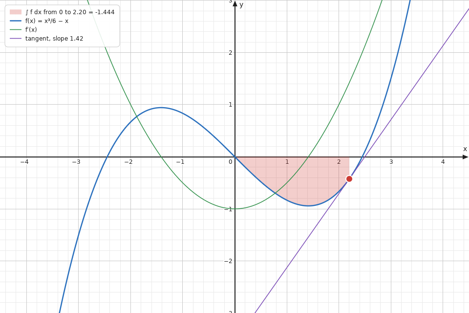
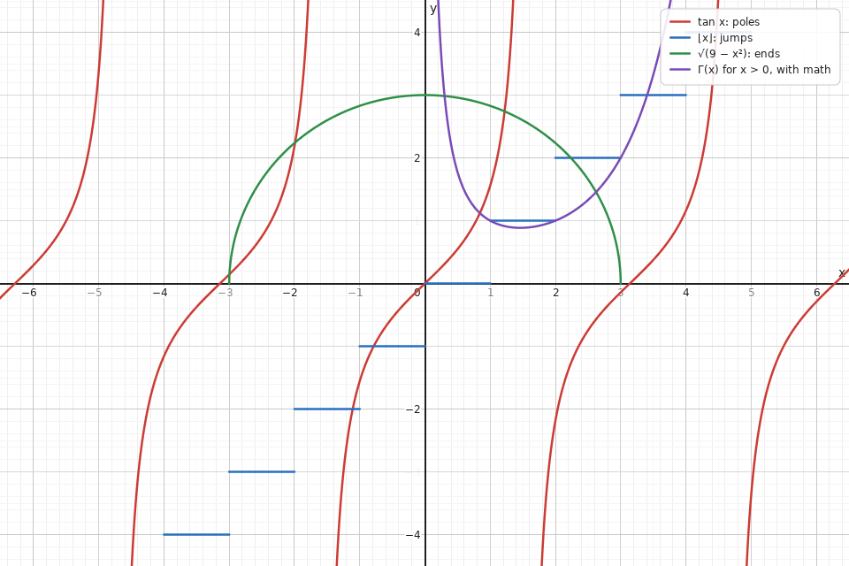
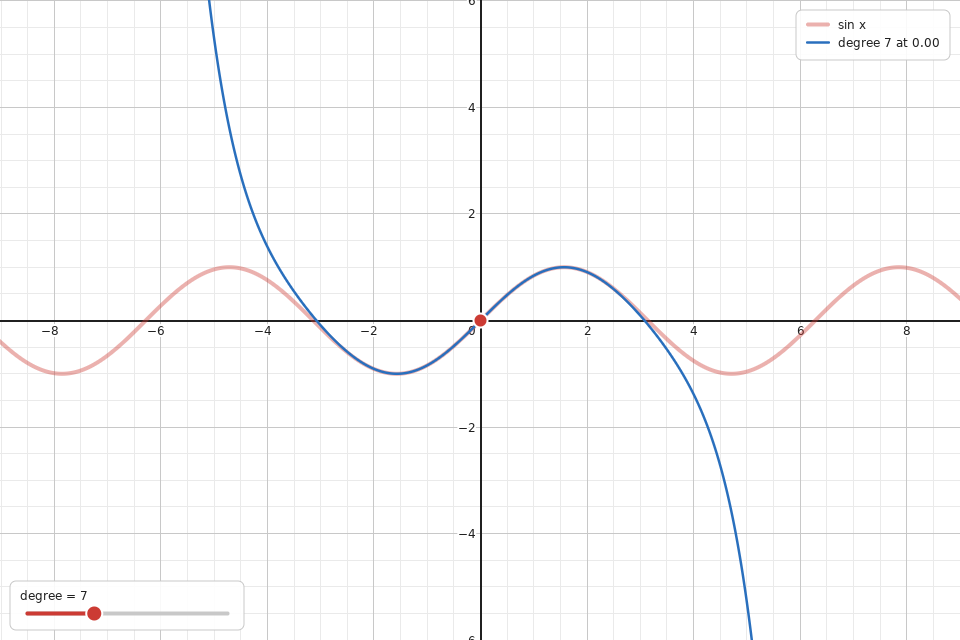
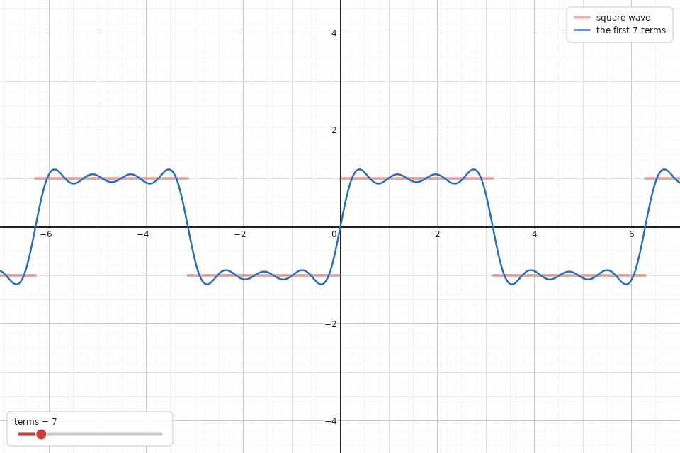
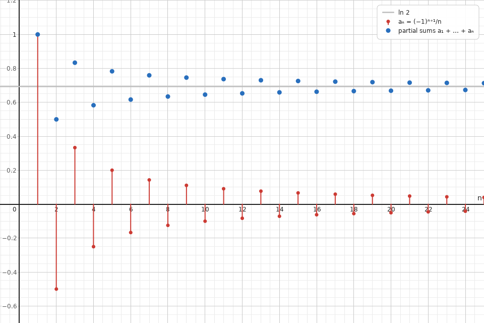

# Functions and calculus

Graphs of functions `y = f(x)`, and the calculus helpers that turn a
function into another one to plot or evaluate: exact derivatives,
integrals and antiderivatives, Taylor polynomials and Fourier series. The
terms of sequences, drawn one by one, close the page.



*A tangent from `pgp.derivative`, and an area and its value from `pgp.integral` ([`examples/calculus.py`](../../examples/calculus.py))*

On this page: [Functions](#functions) · [Derivatives](#derivatives) · [Integrals and antiderivatives](#integrals-and-antiderivatives) · [Taylor polynomials and Fourier series](#taylor-polynomials-and-fourier-series) · [Sequences](#sequences).

## Functions



*Poles, jumps and domain edges are drawn correctly ([`examples/functions.py`](../../examples/functions.py))*

```py
grid.plot(surface, func, *, color=None, width=None, opacity=None,
           domain=None, style=None, sampling=None)
```

```python
grid.plot(screen, np.sin)
grid.plot(screen, lambda x: x**2 / 4, color="crimson", width=4)
grid.plot(screen, np.sqrt, domain=(0, 4))             # only 0 <= x <= 4
grid.plot(screen, math.gamma)                         # scalar-only functions work too
```

`func` maps x to y. It can be:

- **vectorised**, written with NumPy (`np.sin`, `lambda x: x**2`). This is
  the fastest kind: it is called with arrays of x values.
- **scalar-only**, written with `math` or with `if` statements. It is
  detected automatically (the first call with an array fails or returns the
  wrong shape) and then called one x at a time.

It does not need to be well behaved. Wherever it raises an error, returns
NaN or infinity, or returns a complex number with a real imaginary part,
there is simply a gap; a frame never crashes because of a plotted function.
The plot is also faithful where functions are hard to draw:

- **Jumps** (`np.floor`) and **poles** (`1/x`, `np.tan`, `math.gamma`) are
  never joined by vertical lines, and each branch of a pole runs off the
  edge of the plane.
- **Domain edges** are found exactly: `np.sqrt` starts at the origin, and
  `np.log` dives off the bottom of the plane as x approaches 0.
- **Fine detail** is sampled adaptively, so curves stay smooth however far
  you zoom in, and narrow features are not missed.

| Parameter | Default | Meaning |
|---|---|---|
| `color` | next palette colour | Line colour. |
| `width` | `2.5` | Line width in pixels (fractional widths are fine). |
| `opacity` | `1.0` | Line opacity, 0 to 1. |
| `domain` | `None` | Only plot where `domain[0] <= x <= domain[1]`. |
| `style` | `None` | A reusable `LineStyle`; the keyword arguments override it. |
| `sampling` | the plane's | A `FunctionSampling` for this call. |

### Sampling settings

Sampling is automatic and you will rarely need to change it. If you do, a
`FunctionSampling` can be passed to `plot` or set for the whole plane
(`Grid(sampling=...)` or `grid.sampling = ...`):

| Field | Default | Meaning |
|---|---|---|
| `samples_per_px` | `1.0` | Initial samples per pixel column. |
| `tolerance_px` | `0.25` | Largest allowed distance between the curve and the drawn line. |
| `max_rounds` | `8` | Refinement depth (jumps are located to 1/256 of a pixel). |
| `max_samples` | `16384` | Budget of evaluations per function per frame. |
| `jump_px` | `1.0` | Smallest unresolved rise treated as a discontinuity. |

### Late binding

When creating functions in a loop, bind the loop variable as a default
argument:

```python
powers = [lambda x, k=k: x**k for k in range(1, 4)]   # x, x², x³
for f in powers:
    grid.plot(screen, f)
```

Without the `k=k`, all three functions would use the last `k`, because a
lambda looks its variables up when it is called, not when it is created. The
same applies to animation variables captured by lambdas inside a loop.

## Derivatives

`pgp.derivative(f, n)` returns the `n`-th derivative of a function of one
variable, itself a function: plot it, call it at a point, or pass it
anywhere a function is expected.

```py
pgp.derivative(func, n=1)          # f⁽ⁿ⁾, a function of x
pgp.derivatives(func, x, n)        # (f(x), f'(x), ..., f⁽ⁿ⁾(x)) at once
```

```python
def f(x):
    return np.sin(x) * np.exp(-x / 4)

grid.plot(screen, f)
grid.plot(screen, pgp.derivative(f))          # f'
grid.plot(screen, pgp.derivative(f, 2))       # f''
slope = pgp.derivative(f)(1.5)                # a number, for a number
value, slope, curvature = pgp.derivatives(f, 1.5, 2)
```

The derivatives are **exact** (to rounding) for functions written with
NumPy, at any order up to 40: the function is not sampled at nearby points
but run with a special number that carries its derivatives along (Taylor
mode automatic differentiation). There is no step size to choose and no
error that grows with the order, and derivatives stay exact right next to
jumps, kinks and poles: the derivative of `np.abs` jumps from -1 to 1 at 0,
that of `np.floor` is 0 between the steps, and neither shows a spike.
Where the function is undefined, so is its derivative.

What can be differentiated exactly:

- arithmetic and powers, `np.sqrt`, `np.cbrt`, `np.exp`, `np.log` (and
  their base-2, base-10, `expm1` and `log1p` forms), trigonometric,
  hyperbolic and inverse functions, `np.arctan2`, `np.hypot`;
- piecewise functions: `np.abs`, `np.sign`, `np.floor` and friends, `%`,
  `np.maximum`/`np.minimum`, `np.where`, `np.clip`, `np.select` and
  `np.piecewise`, with comparisons such as `x > 0`;
- functions written for one number at a time with NumPy and Python `if`
  statements, such as `def f(x): return np.sin(x) if x > 0 else x * x`.
  These are exact too, but differentiated one point at a time, a few
  hundred times more slowly (about 40 µs per point); write them with
  `np.where` if speed matters.

Functions written with the `math` module, or that use something without a
rule (SciPy's special functions, for example), are differentiated
**numerically** instead, by finite differences. That is automatic and works
well for smooth functions (about `1e-10` relative error for a first
derivative, `1e-6` for a fourth), but near a jump or a kink it sees a slope
that is not there (a spike), and it loses accuracy fast at high orders.
Prefer NumPy for anything you differentiate.

A derivative of a derivative simply raises the order:
`pgp.derivative(pgp.derivative(f), 2)` is the third derivative, computed
directly.

### Tangent lines and Taylor polynomials

`derivatives` gives the value and slope together, which is all a tangent
line needs. With a [draggable point](draggable-points.md) on the curve, the
tangent follows the point:

```python
p = grid.draggable(curve=(lambda t: t, f, (-10, 10)), t=1.0)   # before the loop

value, slope = pgp.derivatives(f, p.x, 1)
grid.plot(screen, f)
grid.plot(screen, lambda x: value + slope * (x - p.x))
grid.draw_controls(screen)
```

A Taylor polynomial of degree `n` uses the first `n` derivatives, and
[`pgp.taylor`](#taylor-polynomials-and-fourier-series) builds it:

```python
grid.plot(screen, pgp.taylor(f, p.x, 5))       # degree 5, about the point
```

[`examples/calculus.py`](../../examples/calculus.py) draws a tangent at a point dragged
along the curve, and [`examples/taylor.py`](../../examples/taylor.py) Taylor
polynomials about a point dragged along the x axis.

## Integrals and antiderivatives

```py
pgp.integral(func, a, b)           # ∫ₐᵇ f(x) dx, a number
pgp.antiderivative(func, a=0)      # F(x) = ∫ₐˣ f(t) dt, a function of x
```

```python
area = pgp.integral(np.sin, 0, np.pi)                            # 2.0
bell = pgp.integral(lambda x: np.exp(-x**2), -np.inf, np.inf)    # √π
F = pgp.antiderivative(np.cos)                                   # sin, as F(0) = 0
grid.plot(screen, F)
value = F(1.0)                                                   # a number, for a number
```

`integral` computes a definite integral adaptively (Gauss-Kronrod
quadrature, spending the effort where the function needs it), to about 10
significant digits for smooth functions, for functions with jumps
(`np.floor`) and kinks (`np.abs`), and for singularities that can be
integrated, such as `1/sqrt(x)` or `log(x)` at 0. Either limit may be
infinite, and `b < a` gives the negative of the integral from `b` to `a`.
Functions are written as for `plot`, with NumPy or `math`, and may raise
or return NaN.

When there is no honest number to give, the result is NaN rather than a
wrong one: when the integral diverges (`1/x` across 0, or from 1 to
infinity) and when the function is undefined on part of the interval
(`np.sqrt` from -1). A single point where the function is undefined, like
`sin(x) / x` at 0, makes no difference to an integral and is ignored.

`antiderivative` returns `F(x) = ∫ₐˣ f(t) dt`, with `F(a) = 0`: a function
to plot, evaluate or pass on, like a [derivative](#derivatives). Choose `a`
where the function is defined: the antiderivative of `1/x` from 1 is
`log x`, while from 0 it would be undefined everywhere. Beyond a point where
the integral from `a` diverges, `F` is undefined, so that antiderivative
has no graph for `x < 0`. `a = -np.inf` gives a cumulative distribution,
and `F(np.inf)` the integral to infinity:

```python
normal = lambda x: np.exp(-x**2 / 2) / np.sqrt(2 * np.pi)
cdf = pgp.antiderivative(normal, -np.inf)
grid.plot(screen, cdf)
cdf(1.96)                                       # 0.975
log = pgp.antiderivative(lambda x: 1 / x, 1)    # log x, for x > 0
```

The derivative of an antiderivative is the function itself, and
`pgp.derivative(F)` gives exactly that: `pgp.derivative(F)` is `cos`, not a
numerical difference of `F`.

Plotting an antiderivative costs about as much as integrating over the
plotted range a few times, not once per point: the plotted points are
integrated between neighbours, and `F` is their running total from `a`.
Unchanged antiderivatives are [reused](plotting.md#reusing-unchanged-plots) like
other plots.

### The area under a curve

`fill_between` shades the area and `integral` measures it. With two
[draggable points](draggable-points.md) on the curve, both follow the
points:

```python
p = grid.draggable(curve=(lambda t: t, f, (-10, 10)), t=-1.0)   # before the loop
q = grid.draggable(curve=(lambda t: t, f, (-10, 10)), t=2.0)

grid.fill_between(screen, f, domain=(min(p.x, q.x), max(p.x, q.x)))
grid.plot(screen, f)
grid.draw_controls(screen, p, q)
area = pgp.integral(f, p.x, q.x)        # below the x axis counts as negative
```

Show `area` in a plot's `label=` or with [`grid.text`](shapes-and-text.md#text),
as [`examples/calculus.py`](../../examples/calculus.py) does. For the
area between two graphs, integrate their difference:
`pgp.integral(lambda x: f(x) - g(x), a, b)`, or `np.abs` of it for the
area regardless of which graph is on top.

### Riemann sums

A Riemann sum is a few lines of NumPy, and its rectangles are a step
function for `fill_between` and their outlines one `polyline` (NaN
vertices separate them):

```python
a, b, n = 0.0, 3.0, 12
x = np.linspace(a, b, n + 1)
h = f(x[:-1])                       # left ends; f(x[1:]) right, f((x[:-1] + x[1:]) / 2) midpoints
riemann = h.sum() * (b - a) / n     # tends to pgp.integral(f, a, b) as n grows

step = lambda t: h[np.clip(np.searchsorted(x, t, side="right") - 1, 0, n - 1)]
grid.fill_between(screen, step, domain=(a, b), color="steelblue")
gap = np.full(n, np.nan)
boxes = np.column_stack([x[:-1], 0 * h, x[:-1], h, x[1:], h, x[1:], 0 * h, gap, gap])
grid.polyline(screen, boxes.reshape(-1, 2), width=1.5, color="steelblue")
grid.plot(screen, f)
```

With a [slider](draggable-points.md#sliders) for `n`, the rectangles close in on the
area as you drag. The trapezoidal rule's trapezoids are
`fill_between(screen, lambda t: np.interp(t, x, f(x)), domain=(a, b))`.

### What integrals cannot do

- **Integrals that converge only by cancellation**, such as `sin(x) / x`
  from 0 to infinity, are NaN: the integrand oscillates forever without
  decaying fast enough to be added up piece by piece.
- **Integrands that oscillate many thousands of times** over the interval
  (`sin(10**6 * x)` from 0 to 1) are NaN: the work is limited, so that no
  integral can freeze a frame.
- **Singularities at an end away from 0**, such as `1 / sqrt(1 - x**2)` at
  1, are integrated to about 8 digits rather than 10, and are NaN beyond
  about ±10, because floating point cannot get closer to the singularity
  than about `1e-13` times its distance from 0. Move the singularity to 0:
  `pgp.integral(lambda t: 1 / np.sqrt(t), 0, 1)` rather than
  `pgp.integral(lambda x: 1 / np.sqrt(x - 10), 10, 11)`.
- **A feature much narrower than the interval** (a spike a millionth as wide)
  can be missed if no sample lands on it, as with any numerical integration.
  Integrate over a shorter interval around it.
- **An antiderivative's last digits** can differ between calls, as `F(x)`
  depends a little on the other points it is evaluated with. The values
  agree to about 10 digits, which is invisible in a plot.
- **Singular integrands at the lower limit** (the antiderivative of
  `1/sqrt(x)` from 0) need more work at every point, so plotting one takes
  around 15 ms when it is not reused.

## Taylor polynomials and Fourier series



*A Taylor polynomial of sin x, with its degree on a slider ([`examples/taylor.py`](../../examples/taylor.py))*



*A Fourier series closing in on a square wave ([`examples/fourier.py`](../../examples/fourier.py))*

```py
pgp.taylor(func, a, n)                     # the Taylor polynomial of degree n about a
pgp.fourier(func, n, interval=None)        # the Fourier series with n harmonics, on (-π, π)
```

```python
p5 = pgp.taylor(np.sin, 0, 5)              # x - x³/6 + x⁵/120
grid.plot(screen, np.sin)
grid.plot(screen, p5)
p5.coefficients                            # [0, 1, 0, -1/6, 0, 1/120]

square = pgp.fourier(np.sign, 15)          # a square wave: sign on (-π, π), repeated
grid.plot(screen, square)
square.sines[:4]                           # [0, 4/π, 0, 4/(3π)]
```

Both return functions of `x`, to plot, evaluate or differentiate like any
other. They are computed once, when created, and are then cheap to
evaluate.

`taylor(func, a, n)` is the polynomial `Σ f⁽ᵏ⁾(a) (x - a)ᵏ / k!`, up to
degree 40, from the [exact derivatives](#derivatives) at `a` (to rounding,
for functions written with NumPy; for `math` functions the derivatives are
numerical, good only to the first few orders). Its `coefficients` are
`f⁽ᵏ⁾(a) / k!`, lowest first, and its `center` is `a`.

`fourier(func, n, interval)` is the partial sum

`S(x) = a₀/2 + Σₖ (aₖ cos kωx + bₖ sin kωx)`,  `k = 1 ... n`,  `ω = 2π/T`,

of the Fourier series of the function on `interval` (default `(-π, π)`),
whose length `T` is the period. The function need not be periodic: its
values on the interval are repeated, so `np.sign` gives a square wave,
`lambda x: x` a sawtooth and `np.abs` a triangle wave. Its `cosines` are
`a₀ ... aₙ` and its `sines` `b₀ ... bₙ` (with `b₀ = 0`), and its
`amplitudes` the size of each harmonic, `√(aₖ² + bₖ²)` (and `|a₀|/2`, the
mean): its spectrum, which [`sequence`](#sequences) draws. The coefficients are integrals over the interval, computed
accurately for smooth functions and for jumps and kinks alike. Near a jump
the partial sums overshoot by about 9% however many harmonics there are:
that is the Gibbs phenomenon, a property of the series, not of the
drawing. `n` can be up to 1000; 100 harmonics take about a millisecond to
compute.

```python
saw = pgp.fourier(lambda x: x, 25)                      # period 2π
wave = pgp.fourier(lambda x: x * (1 - x), 5, (0, 1))    # period 1
grid.plot(screen, saw)
grid.plot(screen, wave)
grid.sequence(screen, saw.amplitudes)                   # its spectrum: 2/k
```

With a [slider](draggable-points.md#sliders) for `n` or the degree, the
approximations can be watched converging:
[`examples/fourier.py`](../../examples/fourier.py) does this for a square wave, and
[`examples/taylor.py`](../../examples/taylor.py) for the Taylor polynomials of sin x.

## Sequences



*The terms of the alternating harmonic series, and its partial sums ([`examples/sequences.py`](../../examples/sequences.py))*

```py
grid.sequence(surface, terms, start=0, *, baseline=0, color=None,
               width=None, radius=None, marker=None, opacity=None, style=None)
```

```python
grid.sequence(screen, [3, 1, 4, 1, 5, 9, 2, 6])                  # a₀ ... a₇
grid.sequence(screen, lambda n: (-1) ** n / n, start=1)          # every n ≥ 1
grid.sequence(screen, pgp.fourier(np.sign, 15).amplitudes)       # a spectrum
grid.sequence(screen, lambda n: 1 - 1 / n, start=1, width=0)     # markers alone
```

Each term `aₙ` is drawn at `x = n` as a stem from the x axis to `(n, aₙ)`
with a marker at its end, as in a spectrum or a stem plot. `terms` is:

- **a list or array**: a finite sequence, whose first term has the index
  `start` (0 by default, so the terms of a Python list sit at their
  indices). It is drawn in full; NaN terms are left out;
- **a function of `n`**: an infinite sequence, drawn at every visible
  integer `n >= start`. It is called with a float array of whole numbers,
  so NumPy arithmetic cannot overflow (`2**n` is fine), or, if it only
  works on one value at a time, with each `n` as a Python `int`, so
  `math.factorial`, `math.comb` and list indexing work. Where it raises,
  returns NaN or infinity, the term is left out: `1/n` simply has no term
  at 0.

```python
fib = [1, 1]
while len(fib) < 30:
    fib.append(fib[-1] + fib[-2])
grid.sequence(screen, lambda n: fib[n + 1] / fib[n], width=0)   # → the golden ratio
grid.sequence(screen, lambda n: math.comb(10, n) / 50)          # a row of Pascal's triangle
partial = np.cumsum(1 / np.arange(1, 50) ** 2)
grid.sequence(screen, partial, start=1)                         # → π²/6
```

A limit is a horizontal line, `grid.plot(screen, lambda x: 0 * x + np.pi**2 / 6)`;
with `baseline=` the stems start from it instead of the x axis, so they
shrink as the terms close in:

```python
grid.sequence(screen, partial, start=1, baseline=np.pi**2 / 6)
```

A recurrence `xₙ₊₁ = g(xₙ)` is a few lines of Python building a list:

```python
r, x = 3.5, [0.2]
for _ in range(60):
    x.append(r * x[-1] * (1 - x[-1]))       # the logistic map
grid.sequence(screen, x, width=0)
```

Zoomed in, every term is drawn; zoomed far out, the stems of the terms
that share a pixel column are drawn as one, which covers exactly what they
would together, so even thousands of terms per pixel cost one stem per
pixel. An infinite sequence's terms closer than a quarter of a pixel are
thinned: only multiples of 3, 9, 27, ... are drawn, the others fading out
as you zoom out, so nothing pops and panning stays rigid. Thinning by
powers of 3 keeps odd and even terms alike, so an alternating sequence
stays two-sided and a square wave's odd harmonics stay visible; only a
pattern repeating every 3, 9, ... terms can be misrepresented, and only
when its terms are less than a quarter of a pixel apart. A finite
sequence is never thinned.

On a [log y axis](log-axes.md) the stems reach down to the bottom edge
(a baseline of 0 is infinitely far down) and terms that are not positive
are left out;
markers alone (`width=0`) are often clearer there. On a log x axis the
terms crowd together to the right, and are thinned there in the same way.

| Parameter | Default | Meaning |
|---|---|---|
| `terms` | | A list or 1-D array of numbers, or a function of `n`. |
| `start` | `0` | The index of the first term (a whole number). |
| `baseline` | `0` | Where the stems start: a y value, such as a limit. |
| `color` | next palette colour | Colour of the stems and markers. |
| `width` | `2.0` | Stem width in pixels; `0` for markers alone. |
| `radius` | `3.5` | Marker size in pixels; `0` for stems alone. |
| `marker` | `"circle"` | `"circle"`, `"square"`, `"diamond"`, `"cross"` or `"plus"`. |
| `opacity` | `1.0` | Opacity, 0 to 1. |
| `style` | `None` | A reusable `SequenceStyle`. |

