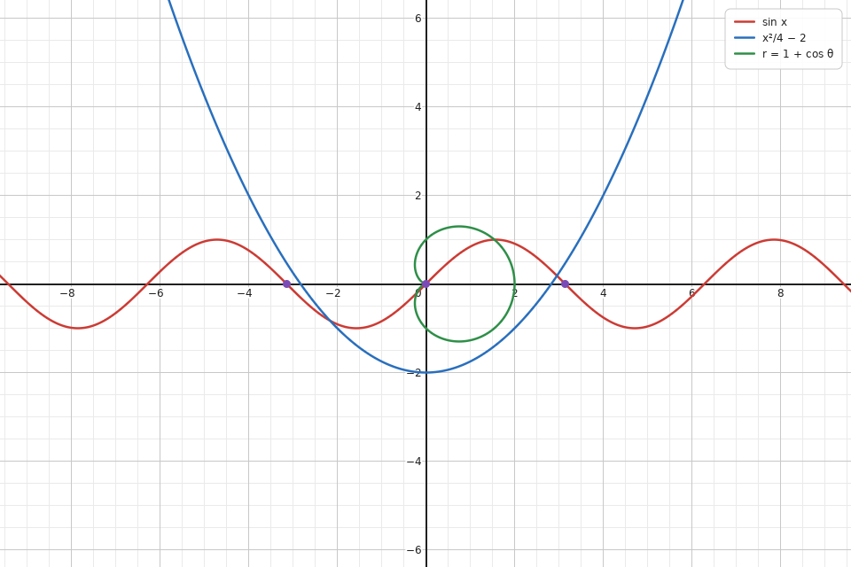

# Getting started

## Installing

```bash
pip install pygridplot
```

PyGridPlot needs Python 3.10 or newer, [pygame-ce](https://pyga.me/) 2.5.7 or
newer, NumPy, and [contourpy](https://contourpy.readthedocs.io/) (for
implicit curves); pip installs them all. To work on PyGridPlot itself,
install it from a checkout of the repository instead:

```bash
pip install -e ".[dev]"     # the library, editable, and the tools for working on it
```

Use pygame **community edition** (`pygame-ce`), not the original `pygame`
package: they install under the same import name, so uninstall `pygame`
first if both are present. Importing PyGridPlot with the original pygame
raises an `ImportError` that says so.

## A first program

```python
import numpy as np
import pygame
import pygridplot as pgp

pygame.init()
screen = pygame.display.set_mode((960, 640), pygame.RESIZABLE)
pygame.display.set_caption("My first grid")
grid = pgp.Grid()                       # fills the window, follows resizes
clock = pygame.time.Clock()

running = True
while running:
    for event in pygame.event.get():
        if event.type == pygame.QUIT:
            running = False
        grid.handle_event(event)         # drag to pan, scroll to zoom

    grid.draw(screen)                    # background, grid, axes, labels
    grid.plot(screen, np.sin, label="sin x")   # then anything on top of it
    grid.plot(screen, lambda x: x**2 / 4 - 2, label="x²/4 − 2")
    grid.polar(screen, lambda a: 1 + np.cos(a), label="r = 1 + cos θ")
    grid.points(screen, [(-np.pi, 0), (0, 0), (np.pi, 0)])
    grid.legend(screen)                  # names the plots with a label
    pygame.display.flip()
    clock.tick(60)
pygame.quit()
```

It draws this (it is [`examples/quickstart.py`](../../examples/quickstart.py)):



Drag with the left mouse button to pan, scroll to zoom about the cursor,
and press `Home` to return to the start. The grid adapts as you zoom:
lines stay about 100 pixels apart, labels never overlap, and new lines
fade in smoothly.

## The frame loop

Everything is **immediate mode**: each frame you draw what you want to see,
and the plane recomputes it from the current view. There are no plot
objects to create, update or delete. Animation is just drawing something
different each frame, and plots follow panning and zooming automatically.

Each frame does three things, in this order:

1. **Pass every event** to `grid.handle_event(event)`, including mouse
   motion (the plane zooms about the cursor, so it tracks the mouse). It
   returns `True` when the plane used the event, so your own code can skip
   it; see [Interaction](interaction.md#handling-your-own-input).
2. **Draw the grid once** with `grid.draw(surface)`. It fills the
   background, draws the grid, axes and labels, advances eased pan and zoom,
   and restarts the colour palette for the new frame.
3. **Draw plots** with `plot`, `points` and the other
   [plotting methods](plotting.md#all-the-methods), in the order they
   should be stacked. Each takes the target surface first, like
   `pygame.draw`, and draws on top of what is there.

Then flip the display as usual. Anything drawn after the plots (captions,
buttons, a heads-up display) appears on top of the plane.

## Quick mode

For a quick look at some functions, without writing a loop:

```python
pgp.show(np.sin, lambda x: x**2 / 4)
pgp.show(np.exp, lambda x: x**3, log_y=True, x_range=(0, 10))
```

`show` opens a resizable window, plots the functions in palette colours and
runs until the window is closed or Escape is pressed. It takes the same
view options as `Grid` (`x_range`, `y_range`, `log_x`, `log_y`, `center`,
`scale`), plus `size`, `title`, `theme`, `width` and `fps`; see the
[reference](reference.md#show).

## Where next

- To control what the plane shows at first (for example x from 0 to 10),
  see [Setting up the view](the-plane.md#setting-up-the-view).
- To plot your own functions, see [Plotting](plotting.md), and for data
  (measurements, samples), [Plotting data](data.md#which-method-to-use); to
  title the axes, label plots in a legend or write text on the plane, see
  [axis titles](the-plane.md#axis-titles-and-arrowheads),
  [legends](shapes-and-text.md#legends) and [text](shapes-and-text.md#text).
- For log scales, see [Logarithmic axes](log-axes.md).
- To change colours, line widths, dashes or the look of the grid, see
  [Styles and themes](styles-and-themes.md).
- To let the user drag points or set values with sliders, see
  [Draggable points and sliders](draggable-points.md).
- For whole programs to start from, see the [examples](examples.md), and
  for worked answers to common tasks, [Recipes](recipes.md).
