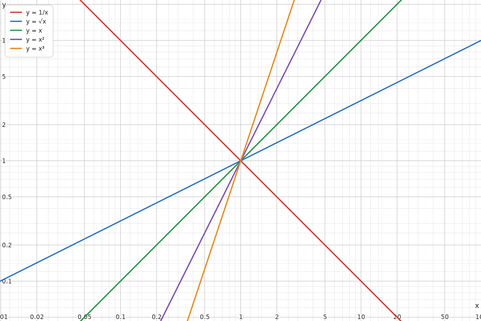

# Logarithmic axes

Either axis of a plane, or both, can be logarithmic (base 10):

```python
grid = pgp.Grid(log_x=True, log_y=True)                            # log-log
grid = pgp.Grid(log_y=True, x_range=(0, 10), y_range=(0.1, 1e5))   # semi-log y
grid = pgp.Grid(log_x=True, x_range=(10, 1e5), y_range=(-60, 10))  # semi-log x
```

On a log axis equal distances are equal *ratios*: every decade (1 to 10,
10 to 100, ...) gets the same space. That makes log axes the natural choice
for data spanning many orders of magnitude, and it turns power laws
(`y = c·xᵏ`, on log-log axes) and exponentials (`y = c·eᵏˣ`, on a log y
axis) into straight lines.

## How log axes behave



*Power laws are straight lines on log-log axes ([`examples/log_axes.py`](../../examples/log_axes.py))*

- **Scale and centre.** The scale of a log axis is in pixels per decade
  (default 150), and its centre must be positive (default 1). Ranges must be
  positive too: `x_range=(0.01, 100)` is fine, `(0, 100)` raises
  `ValueError`.
- **Controls.** Panning, zooming, the keyboard and `Home` work exactly as on
  a linear axis. Zooming about the cursor keeps the value under it fixed.
- **Equal aspect** is off by default when only one axis is logarithmic (a
  pixel per unit and a pixel per decade cannot sensibly be equal) and on for
  log-log planes (equal decades on both axes, so a slope of 1 is at 45°).
- **No zero.** A log axis cannot reach zero, so the other axis' line (where
  the log coordinate would be zero) is never drawn, and the other axis'
  labels stay pinned to the plane's edge.

## The grid

The grid adapts to the zoom level, and every change fades in or out
smoothly, as on a linear axis:

| Zoom | What you see |
|---|---|
| Far out (decades a few pixels apart) | Only every 2nd, 5th, 10th, ... decade is a labelled major line, with the decades in between as minor lines. |
| Ordinary (decades ~100 px apart) | Classic log paper: every decade labelled, with lines at 2, 3, ..., 9 times each power of ten. |
| Closer | 2 and 5 get labels first, then the other integers. Finer subdivisions (1.5, then 1.1, 1.2, ...) appear where there is room. |
| Far in | A log axis looks like a linear one: evenly spaced lines and labels such as 3.71, 3.72, ... |

Spacings are chosen from the local density at each point, so they change
smoothly along the axis instead of jumping at an integer or a power of ten.

## Labels

Labels on a log axis choose their notation one by one, so their text never
changes while you pan across many decades. Values from `0.0001` to
`100000` are written out in full, and other powers of ten are written as
powers (`10⁶`, `10⁻⁵`, and `2×10⁶` for multiples). To switch to powers
sooner, change the theme's [number format](styles-and-themes.md#number-formats):

```python
from dataclasses import replace

fmt = pgp.NumberFormat(sci_large_exponent=4, sci_small_exponent=-3)
grid.theme = replace(grid.theme, number_format=fmt)   # 1000, then 10⁴
```

## Plotting on log axes

- **Functions and curves** are sampled evenly *on screen*, so power laws are
  exactly straight on log-log axes and jumps, poles and domain edges are
  handled as on linear axes. Only positive `x` is plotted on a log x axis,
  and a `domain` is clipped to it. Where `f(x)` is zero on a log y axis the
  curve runs off the bottom edge (zero is infinitely far down), and negative
  values leave gaps.
- **Points, polylines and polygons** are transformed vertex by vertex and
  joined by straight lines on screen, as matplotlib does. A vertex at
  exactly zero lies infinitely far off the edge, so its edges run off the
  plane (a polygon down to y = 0 fills to the bottom, which is what you want
  for the area under a curve). Negative coordinates cannot be shown: such
  points are skipped and such vertices break the line.

## Switching at run time

`grid.log_x` and `grid.log_y` can be assigned at any time, for example
from a key press:

```python
grid.log_y = not grid.log_y
```

The visible range of the axis is kept where the new kind of axis can show
it. Switching to log while zero or negative values are visible keeps the
top three decades below the largest visible value. The equal-aspect setting
follows the automatic rule (unless you chose one explicitly when creating
the plane), and the new view becomes the home view.

See [`examples/log_axes.py`](../../examples/log_axes.py) for power laws on log-log
axes. For working on PyGridPlot, `scripts/grid_playground.py` switches
either axis between linear and logarithmic with `X` and `Y`.
