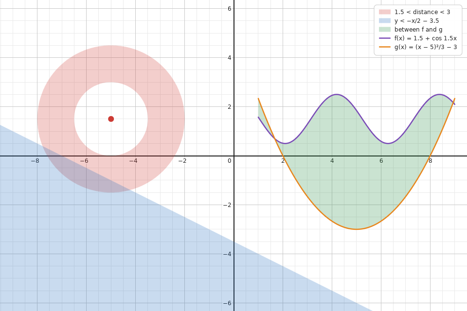
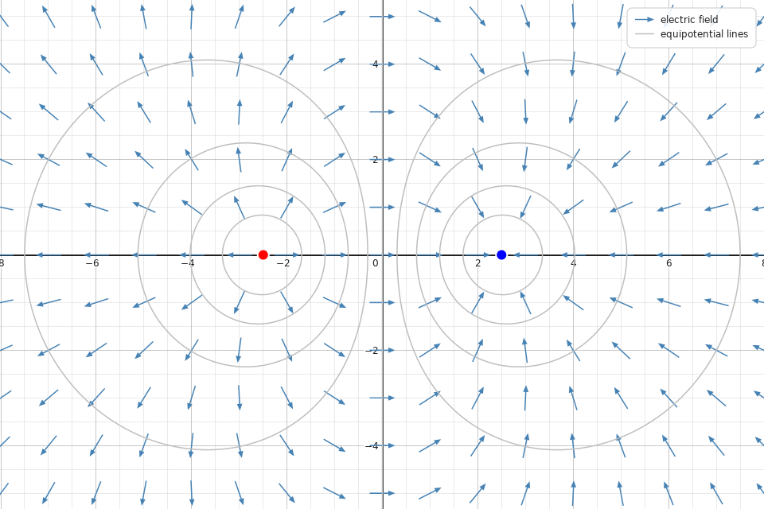
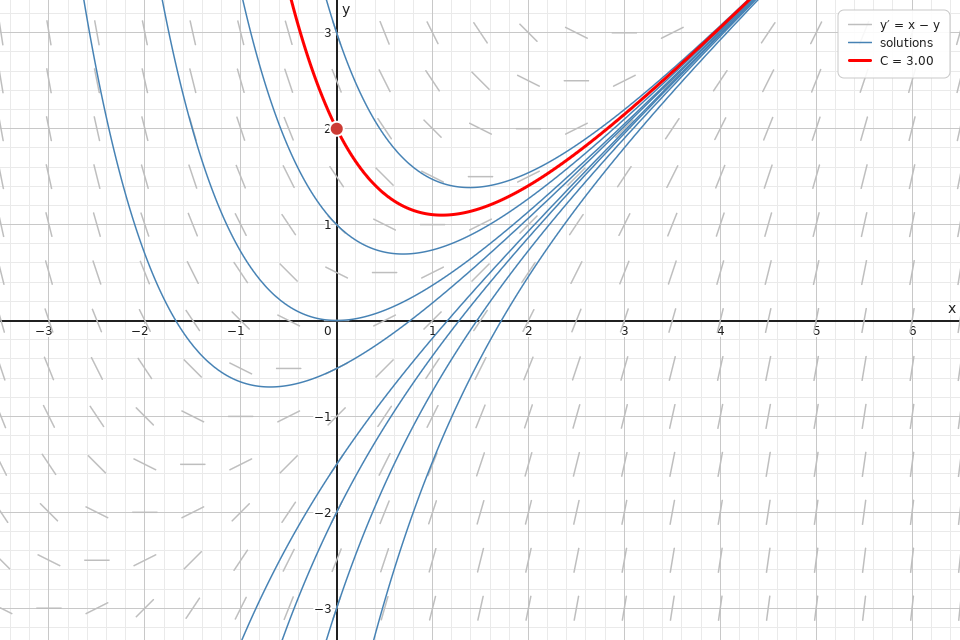

# Regions and fields

Shaded areas between graphs, regions where an inequality holds, and
fields drawn as arrows or short segments on a lattice that pans rigidly
and keeps its density while you zoom.



*A ring around a draggable centre, a half-plane, and the area between two graphs ([`examples/regions.py`](../../examples/regions.py))*

On this page: [Areas between graphs](#areas-between-graphs) · [Inequalities and regions](#inequalities-and-regions) · [Vector fields](#vector-fields) · [Slope fields](#slope-fields).

## Areas between graphs

```py
grid.fill_between(surface, f, g=0, *, color=None, opacity=None,
                   domain=None, style=None, sampling=None)
```

```python
grid.fill_between(screen, np.sin, domain=(0, np.pi))            # under sin, above the x axis
grid.fill_between(screen, np.sin, np.cos, color="crimson")      # between two graphs
grid.fill_between(screen, lambda x: x**2, 4)                    # between a parabola and y = 4
grid.fill_between(screen, np.exp, -math.inf, domain=(-1, 1))    # down to the bottom edge
```

`fill_between` shades the area between the graphs of `f` and `g`, without
an outline. Each side is a function of `x`, written as for `plot`, or a
number for a horizontal line; `g` defaults to `0`, the x axis. Draw the
area first and the curves on top:

```python
grid.fill_between(screen, np.sin, np.cos, domain=(-2, 4), color="steelblue")
grid.plot(screen, np.sin, color="steelblue")
grid.plot(screen, np.cos, color="steelblue")
```

Both sides are sampled exactly like a `plot` of them, so the shading
meets the curves exactly, at every zoom. Where the graphs cross, both
parts are shaded. The area covers only the `x` where both sides are
defined, and ends with a straight edge wherever either side jumps or
ends: `fill_between(screen, np.tan)` shades each branch of `tan` without
joining them across the asymptotes, and
`fill_between(screen, np.sqrt, 0)` starts at `x = 0`.

`math.inf` and `-math.inf` shade all the way to the top or bottom of the
plane. On a [log y axis](log-axes.md), `0` (or any number `<= 0`) lies
infinitely far down, so `fill_between(screen, f)` shades down to the
bottom edge there.

| Parameter | Default | Meaning |
|---|---|---|
| `f`, `g` | (`g`: `0`) | The two sides: functions of `x`, or numbers. |
| `color` | next palette colour | Fill colour. |
| `opacity` | `0.25` | Fill opacity, 0 to 1. |
| `domain` | `None` | Only shade where `domain[0] <= x <= domain[1]`. |
| `style` | `None` | A reusable `FillStyle`. |
| `sampling` | the plane's | `FunctionSampling` for both sides, as for `plot`. |

## Inequalities and regions

```py
grid.inequality(surface, condition, *, color=None, opacity=None,
                 style=None, sampling=None)
```

```python
grid.inequality(screen, lambda x, y: x**2 + y**2 < 4)                      # a disc
grid.inequality(screen, lambda x, y: y > np.sin(x), color="seagreen")      # above a curve
grid.inequality(screen, lambda x, y: (y > x**2 - 2) & (y < 2 - x**2))      # both at once
grid.inequality(screen, lambda x, y: (np.abs(x) > 3) | (np.abs(y) > 2))    # either
```

`inequality` shades every point where `condition(x, y)` is true, without
an outline, like the inequalities of a graphing calculator. The condition
is a Python function of `x` and `y`, written with NumPy like the functions
given to `implicit`, and returning booleans. Combine conditions with
NumPy's `&` (and), `|` (or) and `~` (not), with each part in brackets
(`&` binds more tightly than `<`).

Python's own `and`, `or`, `not` and chained comparisons (`0 < x < 1`) work
too, but only on single numbers, so the condition is then evaluated one
point at a time, tens of times more slowly. Any value that is not zero
counts as true, so functions returning 0 and 1 work as well. Where the
condition raises an error or returns NaN, the point is outside: the region
`lambda x, y: np.sqrt(x) < y` starts at `x = 0`.

To show the boundary, draw it with `implicit` (or `plot`):

```python
grid.inequality(screen, lambda x, y: x**2 + y**2 < 4, color="steelblue")
grid.implicit(screen, lambda x, y: x**2 + y**2, 4, color="steelblue")
```

A region can have any shape: several pieces, holes, parts that end at an
asymptote (`y < tan(x)`), or edges where the condition jumps
(`y < floor(x)`). It is found again every frame on the same grid as
implicit curves, with its edges moved onto the true boundary to a small
fraction of a pixel, and only the neighbourhood of the boundary is
sampled finely, so a large region costs no more than a small one with the
same outline. It takes the same `sampling=` settings as implicit curves
([above](curves.md#implicit-sampling-settings)).

Islands and holes smaller than about 8 pixels across (the coarse grid's
spacing) may be missed, and so may bands thinner than that; zoom in, or
use a smaller `coarse_factor`, to find them.

| Parameter | Default | Meaning |
|---|---|---|
| `condition` | | `condition(x, y)`: true inside. |
| `color` | next palette colour | Fill colour. |
| `opacity` | `0.25` | Fill opacity, 0 to 1. |
| `style` | `None` | A reusable `FillStyle`. |
| `sampling` | `ImplicitSampling()` | How the region is searched for. |

## Vector fields



*The electric field of two draggable charges, with equipotential lines ([`examples/fields.py`](../../examples/fields.py))*

```py
grid.vector_field(surface, field, *, spacing=None, scale=None, color=None,
                   width=None, opacity=None, head_size=None, style=None)
```

```python
grid.vector_field(screen, lambda x, y: (-y, x))                    # a rotation
grid.vector_field(screen, lambda x, y: (x, -y), color="seagreen")  # a saddle
grid.vector_field(screen, lambda x, y: (1, np.sin(x * y)))         # u is a number
```

A vector field gives a vector `(u, v)` at every point of the plane, and is
drawn as arrows on a lattice of points. `field` takes `x` and `y` and
returns the vector there as a pair, written with NumPy like the functions
given to `implicit` (or plain `math`, more slowly). A component may be a
plain number, as in `(1, np.sin(x * y))`. Where the field raises an error,
returns NaN or an infinite component, or is zero, no arrow is drawn.

The arrows are about `spacing` pixels apart (40 by default) at any zoom.
The lattice is fixed to the plane, so panning moves the arrows with it,
and while zooming, new arrows grow and fade in between the others (or
shrink and fade out), so that the density stays the same and nothing
jumps: at any zoom the arrows are between `spacing` and twice that apart.

By default every arrow has the same length, so the picture shows the
field's *direction*. Give `scale` to show its *magnitude* as well: each
arrow is then `scale` pixels long per unit of magnitude, so with
`scale=10` a vector of length 2 is drawn 20 pixels long. Lengths are capped
at 0.8 × `spacing`, so that arrows never run into each other; arrows
shorter than their head are drawn as a smaller head alone.

```python
def electric(x, y):                   # a charge at the origin: E = r / |r|³
    r3 = np.hypot(x, y) ** 3
    return x / r3, y / r3

grid.vector_field(screen, electric)                       # directions: readable everywhere
grid.vector_field(screen, lambda x, y: (-y, x), scale=8)  # 8 px per unit of magnitude
```

Fields such as the one of a point charge, whose magnitude ranges over many
orders, read best by direction alone; fields of moderate size, by
magnitude too. Each arrow is centred on its point of the lattice and is
tangent to the field's flow lines on screen, on log axes as well (a vector
is taken as a direction in world units at its point).

| Parameter | Default | Meaning |
|---|---|---|
| `spacing` | `40` | Distance between neighbouring arrows in pixels (at least 10). |
| `scale` | `None` | `None` for arrows of one length, or pixels per unit of magnitude. |
| `color` | next palette colour | Arrow colour. |
| `width` | `1.5` | Shaft width in pixels. |
| `opacity` | `1.0` | Opacity, 0 to 1. |
| `head_size` | in proportion | Length of the heads in pixels (`0` for none). |
| `style` | `None` | A reusable `ArrowStyle`. |

## Slope fields



*The slope field of y′ = x − y, and its solutions ([`examples/slope_field.py`](../../examples/slope_field.py))*

```py
grid.slope_field(surface, slope, *, spacing=None, color=None, width=None,
                  opacity=None, style=None)
```

```python
grid.slope_field(screen, lambda x, y: x - y)                           # dy/dx = x - y
grid.plot(screen, lambda x: x - 1 + 2 * np.exp(-x), color="crimson")   # one solution
```

A slope field shows the differential equation `dy/dx = slope(x, y)`: a
short segment at each point of a lattice, with the slope the equation
gives there, so that the solution curves can be seen running along the
segments. `slope` takes `x` and `y` like the conditions of `inequality`.
An infinite slope gives a vertical segment, and where `slope` raises an
error or returns NaN no segment is drawn.

The lattice behaves exactly as for [vector fields](#vector-fields):
`spacing` pixels apart (40 by default), fixed to the plane, with segments
fading in and out while zooming. On log axes the segments are tangent to
the solution curves on screen, so `dy/dx = y / x`, whose solutions are the
lines `y = c x`, has every segment at 45° on log-log axes. For arrows
instead of segments, draw the vector field `lambda x, y: (1, slope(x, y))`.

| Parameter | Default | Meaning |
|---|---|---|
| `spacing` | `40` | Distance between neighbouring segments in pixels (at least 10). |
| `color` | next palette colour | Segment colour. |
| `width` | `1.5` | Line width in pixels. |
| `opacity` | `1.0` | Opacity, 0 to 1. |
| `style` | `None` | A reusable `LineStyle`. |

