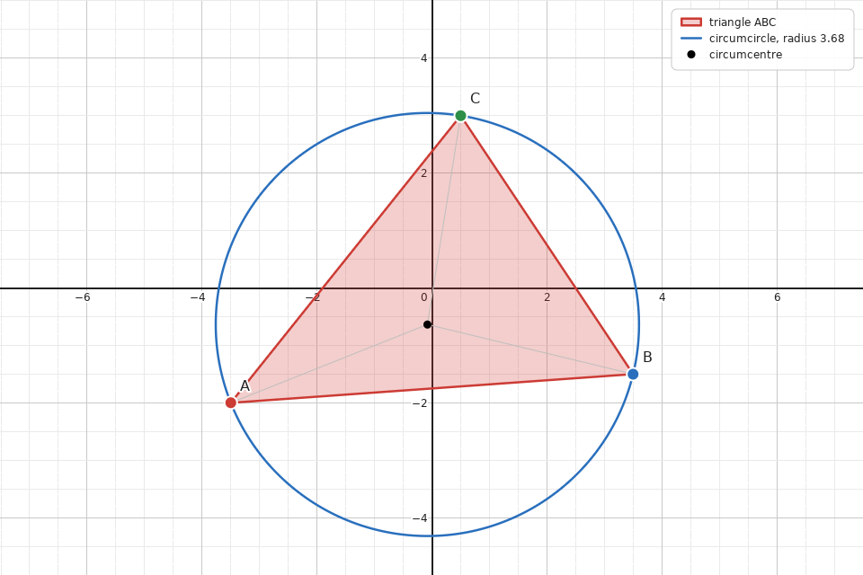
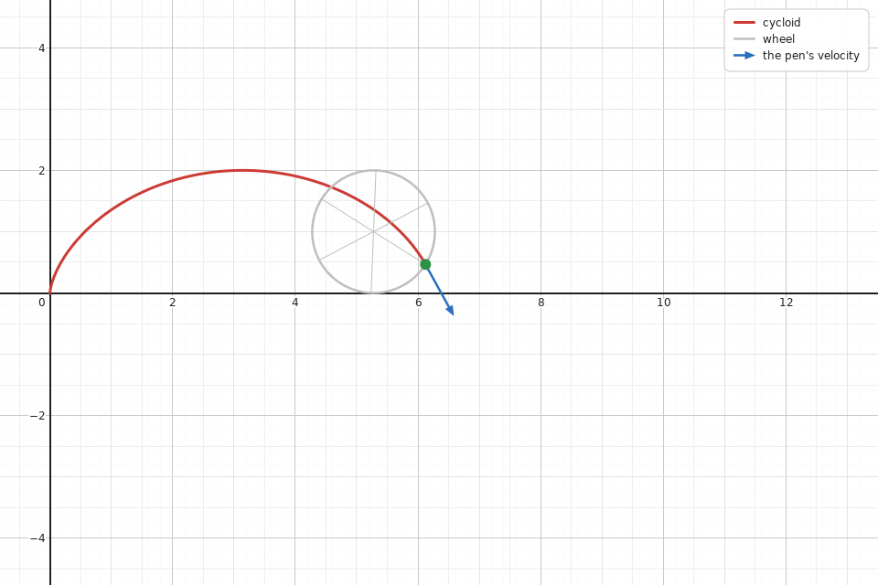

# Shapes, text and legends

Polygons, arrows, text at points of the plane, and the legend that names
the plots of a frame. (Points and polylines, which draw data too, are on
the [data page](data.md#points).)



*A polygon, a circle drawn with `parametric`, points, lines and text ([`examples/geometry.py`](../../examples/geometry.py))*

On this page: [Polygons](#polygons) · [Arrows](#arrows) · [Text](#text) · [Legends](#legends).

## Polygons

```py
grid.polygon(surface, points, *, color=None, width=None, opacity=None,
              fill=None, fill_color=None, fill_opacity=None, fill_rule=None,
              style=None)
```

```python
grid.polygon(screen, [(-3, -1), (-1, -1), (-2, 1)])                 # translucent triangle
grid.polygon(screen, [(0, 0), (2, 0), (2, 1), (0, 1)], fill_opacity=0.6, width=0)
```

A polygon is a translucent fill with an outline; it closes itself.

| Parameter | Default | Meaning |
|---|---|---|
| `color` | next palette colour | Outline colour, also used for the fill. |
| `width` | `2.5` | Outline width in pixels; `0` for no outline. |
| `opacity` | `1.0` | Outline opacity. |
| `fill` | `True` | Whether to fill. |
| `fill_color` | same as `color` | Fill colour. |
| `fill_opacity` | `0.25` | Fill opacity. |
| `fill_rule` | `"nonzero"` | For outlines that cross themselves: `"nonzero"` fills everything enclosed, `"evenodd"` leaves doubly enclosed areas (such as a star's centre) empty. |
| `style` | `None` | A reusable `PolygonStyle`. |

To shade the area under a curve, or between two curves, use
[`fill_between`](regions-and-fields.md#areas-between-graphs).

## Arrows



*An arrow for the velocity of the point drawing a cycloid ([`examples/animation.py`](../../examples/animation.py))*

```py
grid.arrow(surface, start, end, *, color=None, width=None, opacity=None,
            head_size=None, style=None)
```

```python
grid.arrow(screen, (0, 0), (2, 1))                                  # one arrow
grid.arrow(screen, (0, 0), [(3, 0), (0, 3)], color="crimson")       # two, from the origin
grid.arrow(screen, (1, -2), (4, -1), width=4, opacity=0.5)
```

An arrow runs straight from `start` to its tip at `end`, both points in
world units, so it moves and grows with the zoom; its width and head are
in pixels, so it looks the same at every zoom. Draw a vector `v` at a
point `p` with `grid.arrow(screen, p, np.add(p, v))`.

Each of `start` and `end` is one point `(x, y)` or many (a sequence of
points, or an `(N, 2)` array): many arrows in one call are much faster than
one call each. A single start is shared by all the ends, and a single end
by all the starts. Arrows with a NaN coordinate, or whose ends are in the
same place, are left out.

An arrow is filled as one shape, shaft and head together, so translucent
arrows have no darker patch where the head joins the shaft, and arrows
that overlap merge rather than darken each other. Its tail is square.

| Parameter | Default | Meaning |
|---|---|---|
| `color` | next palette colour | Arrow colour. |
| `width` | `2.5` | Shaft width in pixels. |
| `opacity` | `1.0` | Opacity, 0 to 1. |
| `head_size` | in proportion | Length of the head in pixels: by default about `3 × width + 4`; `0` for none (a plain segment with square ends). An arrow shorter than its head is drawn as a smaller head alone. |
| `style` | `None` | A reusable `ArrowStyle`. |

## Text

```py
grid.text(surface, text, position, *, anchor="center", gap=0, color=None,
           size=None, opacity=None, halo=None, style=None)
```

```python
grid.text(screen, "A", (1, 2))                                   # centred on (1, 2)
grid.points(screen, (np.pi / 2, 1))
grid.text(screen, "maximum", (np.pi / 2, 1), anchor="bottom", gap=8)
grid.text(screen, "y = sin x", (4, -1), anchor="left", color="crimson")
grid.text(screen, "two lines\nof text", (-3, 2), anchor="top-left", size=16)
```

Text is written at a world point and moves with it while you pan and zoom,
keeping its size in pixels, like a marker. `anchor` is the point of the
text's box that is placed at `position`: `"bottom"` puts the text above the
point, `"left"` to its right (the point is at the text's left), `"top-left"`
below and to its right, and so on round the box:

| Anchor | The text is | Anchor | The text is |
|---|---|---|---|
| `"center"` | centred on the point | | |
| `"left"` | to the right | `"right"` | to the left |
| `"top"` | below | `"bottom"` | above |
| `"top-left"` | below right | `"top-right"` | below left |
| `"bottom-left"` | above right | `"bottom-right"` | above left |

`gap` moves the text that many pixels further from the point, on the
anchored sides, so that a label sits beside a marker instead of on it:
`gap=8` clears a default point. The box runs from the top of the letters
to the lowest reach of the font's descenders, so text with and without a
`g` or `y` sits alike. `"\n"` starts a new line; lines are aligned to the
anchor's side (left-aligned for the left anchors, right-aligned for the
right ones, centred otherwise).

To label something that moves, write the text at its position every frame.
A draggable point's label, or a value read from a slider, is one line:

```python
p = grid.draggable((1, 1))                                       # before the loop

grid.draw_controls(screen, p)
grid.text(screen, f"({p.x:.1f}, {p.y:.1f})", p.position, anchor="bottom-left", gap=10)
```

To place text beside a point *away* from a shape (a vertex name outside
its triangle, say), choose the anchor from the direction to the point: from
the triangle's centre to the vertex, `"bottom-left"` for a vertex up and to
the right, and so on.

Text is drawn with the theme's label font and, unless given a colour, its
label colour: text never takes [palette](styles-and-themes.md#the-palette)
colours, so labelling a plot does not change the colours of the plots
drawn after it (pass the plot's colour to match it). The label halo, an
outline in the background colour, keeps it readable over grid lines and
curves; `halo=False` turns it off. A position that is NaN (or not positive
on a log axis) draws nothing. Text is not rotated, and has no
typesetting beyond lines: use Unicode for symbols (`π`, `²`, `≤`).

| Parameter | Default | Meaning |
|---|---|---|
| `text` | | The text; `"\n"` starts a new line. |
| `position` | | The world point `(x, y)` the text is anchored to. |
| `anchor` | `"center"` | Which point of the text's box is at `position` (above). |
| `gap` | `0` | Pixels between the point and the text, on the anchored sides. |
| `color` | label colour | Text colour. |
| `size` | label size | Font size in points (a whole number). |
| `opacity` | `1.0` | Opacity, 0 to 1. |
| `halo` | `True` | Outline the glyphs in the background colour. |
| `style` | `None` | A reusable `TextStyle`. |

## Legends

```py
grid.legend(surface, *, corner="top-right")
```

```python
grid.plot(screen, np.sin, label="sin x")
grid.plot(screen, np.cos, label="cos x")
grid.fill_between(screen, np.sin, np.cos, label="between")
grid.points(screen, [(0, 0), (np.pi, 0)], label="roots of sin")
grid.legend(screen)
```

Every plotting method takes a `label=`. The legend lists the labelled calls
made since the frame began (at `grid.draw`), in order, each beside a small
sample of the plot in its own style and colour: a line for curves,
polylines and slope fields, a filled box for areas and regions, a box with
its outline for polygons, a marker for points, a stem with its marker for
sequences, and an arrow for arrows and vector fields. Thick lines and big
markers are drawn smaller there, so they fit their rows. Calls without a
label are left out, so a legend can name just the plots that matter.

The legend is redrawn every frame from that frame's calls, like everything
else, so it always shows what is on the plane: a plot that comes and goes
comes and goes from the legend too. A call repeated exactly, with the same
label, style and colour, is listed once, so a plot drawn in several pieces
can label every piece. With no labelled calls, nothing is drawn.

Call `legend` after the plots, so it is on top of them. It is drawn in a
panel in a corner of the plane, the same as the panels of
[sliders](draggable-points.md#sliders), and like them it stays put while
you pan and zoom; presses on it never pan the plane, and draggable points
under it cannot be grabbed. A legend in the same corner as sliders sits
beyond their panel, so the sliders never move. The labels use the theme's
label font and colour.

| Parameter | Default | Meaning |
|---|---|---|
| `corner` | `"top-right"` | `"top-right"`, `"top-left"`, `"bottom-left"` or `"bottom-right"`. |

| Plotting call's argument | Default | Meaning |
|---|---|---|
| `label` | `None` | The plot's name in the legend: one line of text, or `None` (or `""`) for none. |

