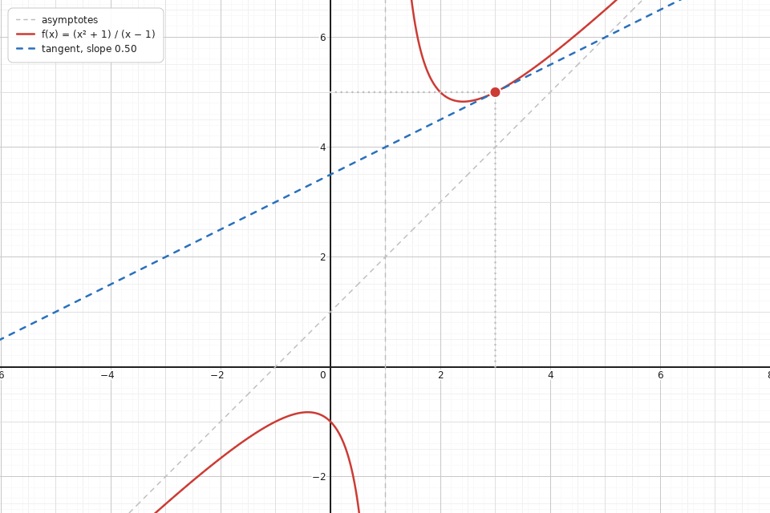
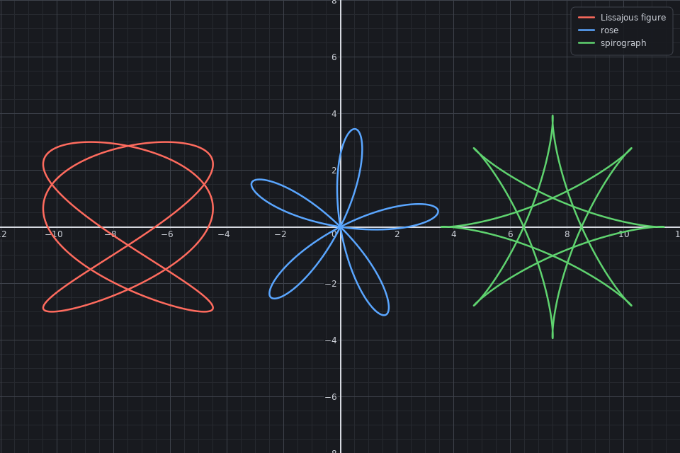

# Styles and themes

**Styles** control how plotted objects look; the **theme** controls how the
plane itself looks (background, grid, axes and labels) and provides the
default colours of plots.

## Colours

Anywhere a colour is accepted, you can use whatever pygame accepts:

```python
grid.plot(screen, np.sin, color="crimson")             # a colour name
grid.plot(screen, np.cos, color="#2d70b3")             # a hex string
grid.plot(screen, np.tan, color=(46, 143, 72))         # RGB
grid.plot(screen, np.exp, color=(200, 40, 40, 128))    # RGBA: half transparent
grid.plot(screen, np.log, color=pygame.Color("gold"))
```

`opacity` multiplies a colour's own alpha, so `color=(200, 40, 40, 128)`
with `opacity=0.5` is a quarter opaque.

## The palette

Objects drawn without a colour take the theme's palette colours in order:
the first plot of a frame gets the first colour, the second the next, and so
on, wrapping around after the last. `grid.draw` restarts the sequence every
frame, so each object keeps its colour as long as you draw things in the
same order. Objects with an explicit colour do not use up a palette slot.

If you draw plots without calling `grid.draw` (on a plane whose grid you
draw elsewhere, say), call `grid.begin_frame()` at the start of each frame
instead.

The palette is part of the theme, so a custom one is a theme change:

```python
from dataclasses import replace

grid.theme = replace(pgp.LIGHT, palette=("#0072b2", "#e69f00", "#009e73", "#cc79a7"))
```

## Reusable styles

Keyword arguments are handy for one-off calls. For a look you reuse, build
a style object once and override fields per call:

```python
thin = pgp.LineStyle(width=1.5, opacity=0.6)
grid.plot(screen, np.sin, style=thin)
grid.plot(screen, np.cos, style=thin, color="crimson")    # override one field

big = pgp.PointStyle(radius=7, marker="diamond", edge_color="white")
grid.points(screen, [(0, 0), (1, 1)], style=big)

hatch = pgp.PolygonStyle(fill_opacity=0.1, width=1.0, fill_rule="evenodd")
grid.polygon(screen, [(0, 0), (2, 0), (1, 2)], style=hatch)

pointer = pgp.ArrowStyle(width=3, head_size=14, color="crimson")
grid.arrow(screen, (0, 0), (2, 2), style=pointer)

bars = pgp.SequenceStyle(width=4, radius=0)          # stems alone, like bars
grid.sequence(screen, [1, 0.5, 0.25, 0.125], style=bars)

solid = pgp.BarStyle(opacity=1.0, edge_width=0)      # solid bars, no outline
grid.bars(screen, [3, 1, 2], style=solid)

note = pgp.TextStyle(size=11, color="gray")
grid.text(screen, "an aside", (1, -1), style=note)
```

A style replaces the method's own defaults as a whole, so
`vector_field(..., style=pgp.ArrowStyle())` draws arrows 2.5 pixels wide
rather than the field's usual 1.5; set the fields you want in the style.

| Style | Used by | Fields (defaults) |
|---|---|---|
| `LineStyle` | `plot`, `parametric`, `polar`, `implicit`, `polyline`, `slope_field` | `color=None`, `width=2.5`, `opacity=1.0`, `dash="solid"` ([dashed and dotted lines](#dashed-and-dotted-lines); slope fields are always solid) |
| `PointStyle` | `points` | `color=None`, `radius=4.5` (`0` for none), `marker="circle"`, `edge_color=None`, `edge_width=1.5`, `opacity=1.0`, `error_width=1.5`, `error_cap=8.0` (error bars) |
| `PolygonStyle` | `polygon` | `color=None`, `width=2.5`, `opacity=1.0`, `fill=True`, `fill_color=None`, `fill_opacity=0.25`, `fill_rule="nonzero"`, `dash="solid"` (the outline's) |
| `FillStyle` | `fill_between`, `inequality` | `color=None`, `opacity=0.25` |
| `ArrowStyle` | `arrow`, `vector_field` | `color=None`, `width=2.5`, `opacity=1.0`, `head_size=None` (in proportion to the width; `0` for none) |
| `SequenceStyle` | `sequence` | `color=None`, `width=2.0` (stems; `0` for none), `radius=3.5` (markers; `0` for none), `marker="circle"`, `opacity=1.0` |
| `BarStyle` | `bars`, `histogram`, `box_plot`, `violin_plot` | `color=None`, `opacity=0.5` (the fill), `edge_width=1.5` (the outline, opaque; `0` for none) |
| `TextStyle` | `text` | `color=None` (the theme's label colour, never a palette colour), `size=None` (the theme's label size), `opacity=1.0`, `halo=True` |

Styles are immutable and validated when they are created, so a mistake such
as a negative width raises a clear `ValueError` at once rather than in the
middle of drawing. Derive variations with `dataclasses.replace`.

## Dashed and dotted lines



*A dashed tangent and dashed asymptotes, with dotted guides ([`examples/line_styles.py`](../../examples/line_styles.py))*

Every line can be dashed or dotted with `dash=`: graphs (`plot`), curves
(`parametric`, `polar`, `implicit`), polylines, and the outlines of
polygons.

```python
grid.plot(screen, np.sin, dash="dashed")
grid.plot(screen, np.cos, dash="dotted")
grid.polyline(screen, [(-2, -3), (-2, 3)], dash=(12, 4, 0, 4))    # dash, dot, dash...
grid.polygon(screen, [(0, 0), (2, 0), (1, 2)], fill=False, dash="dashed")

construction = pgp.LineStyle(width=1.5, color="gray", dash="dashed")
grid.plot(screen, lambda x: x / 2, style=construction)
grid.plot(screen, lambda x: -x / 2, style=construction, dash="solid")  # this one whole
```

| `dash` | Draws |
|---|---|
| `"solid"` | A whole line (the default). |
| `"dashed"` | Dashes `3 × width + 2` pixels long with gaps of `2 × width + 2` (9.5 and 7 pixels at the default width). |
| `"dotted"` | Round dots as wide as the line, `2.5 × width + 1` pixels apart. |
| `(12, 6)` | Your own pattern: the lengths in pixels of the dashes and the gaps between them, alternately, starting with a dash (any even number of lengths). A dash of `0` is a dot. |

Lengths are measured along the line on screen, so a pattern looks the same
at every zoom level and on log axes. The named patterns grow with the
width, so a thick dashed line looks like a thin one enlarged; lengths you
give stay as given. Dashes have round ends, like every line, and their
length includes them: a dash shorter than the line's width is a dot as
wide as the line.

**The dashes stay put while panning.** The pattern is fixed to the plane,
not to the edge of the window, so panning moves every dash exactly with
its line, as it moves every plotted pixel. (It is laid out between points
where the line crosses invisible lines fixed to the plane, a few dashes
apart, and stretched or squeezed slightly to fit a whole number of dashes
between them.) A polyline starts and ends with a dash and has a dash bent
round each corner, as has a polygon's outline; a graph with a `domain`
starts and ends with a dash at its ends, and a parametric curve at the
ends of its range.

**While zooming**, the dashes stay on the line as it grows or shrinks, and
where a gap has room for another dash, one grows in smoothly. Once per
doubling of the zoom the pattern is laid out afresh, so the dashes shift
at that moment.

Limits:

- The pattern is a few percent longer or shorter in some places than in
  others (up to about 9%), as it is fitted between its fixed points. In
  some stretches between them, one dash is longer than the rest, or split
  by a narrow gap: the next dash, growing in. Where a curve turns from
  shallow to steep, a dash may also be a little longer or shorter.
- Slope fields are always solid (their segments are too short for a
  pattern); a dashed style raises `ValueError`.
- A dashed curve costs a little more than a solid one, typically 10–30%,
  as it is sampled a little beyond the plane: the pattern is fitted to
  whole stretches of the line, including those running off the edge.

## Themes



*The built-in dark theme, pgp.DARK ([`examples/curves.py`](../../examples/curves.py))*

`pgp.LIGHT` (the default) and `pgp.DARK` are ready-made. Themes are frozen
dataclasses: derive variations with `dataclasses.replace`, and pass them to
`Grid(theme=...)` or assign `grid.theme` at any time.

```python
from dataclasses import replace

grid.theme = pgp.DARK
grid.theme = replace(pgp.DARK, axis_color=(120, 190, 255), target_major_px=120)
grid.theme = replace(pgp.LIGHT, show_minor=False, label_size=14)
```

### Colours and lines

| Field | Default (`LIGHT`) | Meaning |
|---|---|---|
| `background` | white | Fill colour, or `None` to draw over whatever is already on the surface. |
| `minor_color`, `major_color`, `axis_color` | light grey, grey, near black | Grid line and axis colours. |
| `label_color` | near black | Tick label colour. |
| `label_halo_color` | `None` | Outline around label glyphs, keeping them readable over lines; `None` uses `background`. |
| `minor_width`, `major_width`, `axis_width` | `1`, `1`, `2` | Line thickness in pixels. |
| `show_minor`, `show_major`, `show_axes`, `show_labels` | `True` | Turn parts of the grid on or off. |
| `show_arrows` | `False` | End each axis in an arrowhead at its positive end (see [axis titles and arrowheads](the-plane.md#axis-titles-and-arrowheads)). |
| `palette` | six colours | Default colours for plotted objects, in order. |

`DARK` changes the colours and uses a lighter palette that stands out on
its near-black background.

### Spacing and transitions

| Field | Default | Meaning |
|---|---|---|
| `target_major_px` | `100` | Preferred distance between major lines, in pixels. |
| `spacing_rule` | `"nearest"` | Round spacings to the nearest 1-2-5 step (lines 63–158 px apart), or `"ceil"` to round up (at least the target). |
| `transition` | `"fade"` | `"fade"` cross-fades between spacings while zooming; `"snap"` switches instantly. |
| `fade_band` | `0.05` | Width of each cross-fade, in decades of zoom (about ±12%). |
| `hysteresis` | `0.04` | In `"snap"` mode, extra zoom needed before a switch reverses, so the grid never flickers. |

### Labels

| Field | Default | Meaning |
|---|---|---|
| `label_font` | `None` | `None` for the bundled DejaVu Sans, a path to a font file, or the name of a system font. |
| `label_size` | `12` | Font size in points. |
| `title_size` | `14` | Font size of the [axis titles](the-plane.md#axis-titles-and-arrowheads), in points. |
| `label_halo_width` | `2` | Halo thickness in pixels (`0` turns it off). |
| `label_gap` | `4` | Pixels between an axis and its labels. |
| `label_edge_margin` | `4` | Margin between pinned labels and the plane's edge. |
| `label_min_separation` | `14` | Comfortable gap between labels; closer labels fade out and are thinned. |
| `hang_minus` | `True` | Centre x labels on their digits and let a minus sign hang to the left. |
| `number_format` | `NumberFormat()` | How numbers are written (below). |

## Number formats

Tick labels are formatted exactly (never `0.30000000000000004` or `-0`).
`NumberFormat` decides when scientific notation is used:

| Field | Default | Meaning |
|---|---|---|
| `sci_large_exponent` | `6` | Magnitudes of `10**6` and above may be written in scientific notation. |
| `sci_small_exponent` | `-4` | Magnitudes below `10**-4` may be written in scientific notation. |
| `minus` | `"−"` | The minus sign (a true minus, U+2212). |
| `times` | `"×"` | The multiplication sign in `2×10⁶`. |

On a linear axis, labels share one notation, chosen to be the shorter, so an
axis never mixes `500000` with `1×10⁶`; with fine spacing near `10⁶`,
`1000000.25` beats `1.00000025×10⁶`. On a log axis each label chooses on its
own, so labels never change while panning across decades (see
[Logarithmic axes](log-axes.md#labels)).

```python
grid.theme = replace(grid.theme, number_format=pgp.NumberFormat(minus="-"))
```
