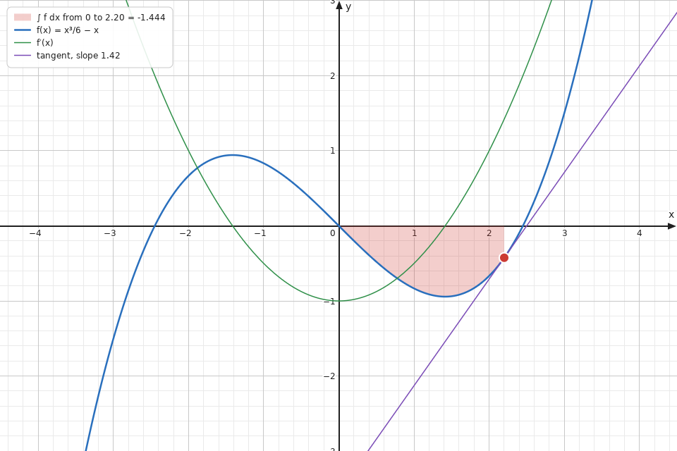
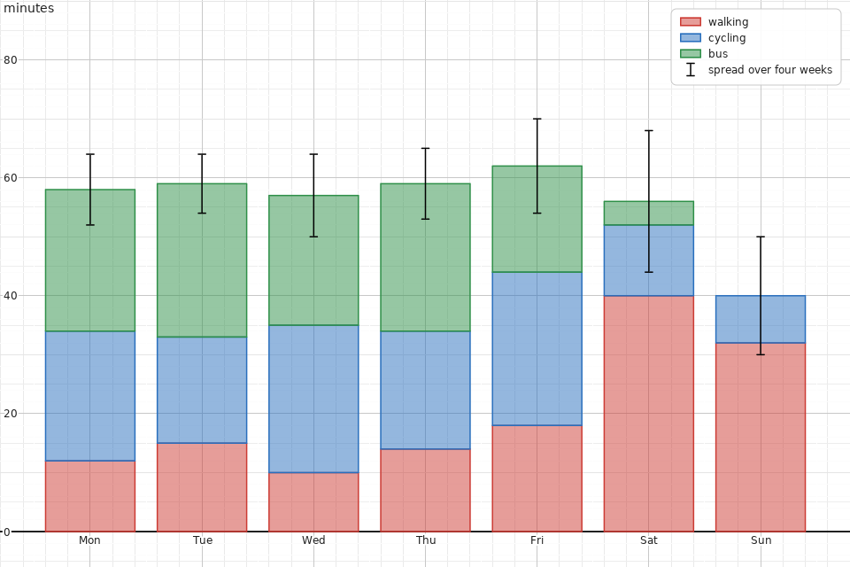
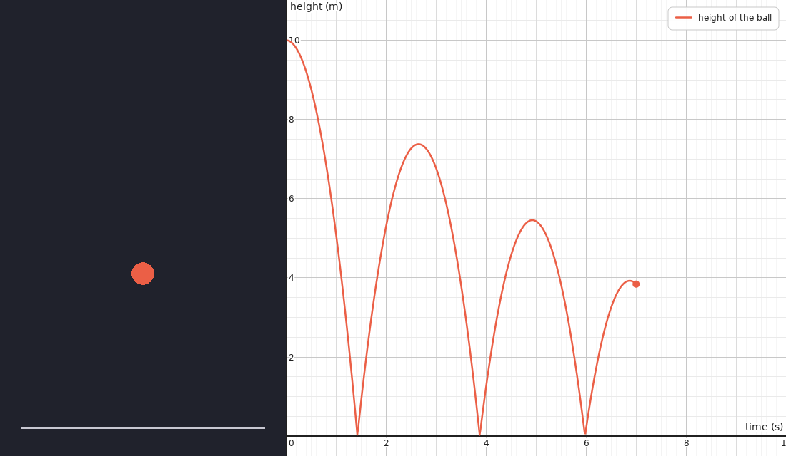

# The plane

A `Grid` is the whole interactive plane: what part of the world it shows
(its [view](#the-view)), how it looks (its [theme](styles-and-themes.md)),
its [controls](interaction.md) and the renderer that draws it.

```py
pgp.Grid(rect=None, *, x_range=None, y_range=None, log_x=False, log_y=False,
          center=None, scale=None, equal_aspect=None, theme=None,
          interactive=True, interaction=None, limits=None, renderer=None,
          sampling=None)
```

| Parameter | Meaning |
|---|---|
| `rect` | Screen rectangle to draw into (a `pygame.Rect` or `(x, y, w, h)`). `None` fills the surface given to `grid.draw` and follows window resizes. |
| `x_range`, `y_range` | `(min, max)` to show across the plane's width or height at first, like a graphing calculator's window settings. They override `center` and `scale` for that axis. |
| `log_x`, `log_y` | Make an axis [logarithmic](log-axes.md) (base 10). |
| `center` | World point shown at the middle of the plane. Default: 0 on a linear axis, 1 on a log axis. |
| `scale` | Pixels per world unit (per decade on a log axis). One number, or `(x_scale, y_scale)` for unequal axes. Default: 50 per unit, 150 per decade. |
| `equal_aspect` | Keep both axes at the same scale, so circles look round. By default (`None`) it is on, unless both ranges are given or only one axis is logarithmic. |
| `theme` | A [`GridTheme`](styles-and-themes.md#themes); default `pgp.LIGHT`. |
| `interactive` | Whether `handle_event` reacts at all. Also an attribute you can toggle. |
| `interaction` | [`InteractionConfig`](interaction.md#configuring-the-controls) for the built-in controls. |
| `limits` | [`ViewLimits`](#zoom-limits) on zooming and panning. |
| `renderer` | A `PygameRenderer` to share between planes (they then share font and label caches). |
| `sampling` | Default [`FunctionSampling`](functions.md#sampling-settings) for `plot`. |

## Setting up the view

There are two ways to say what a plane shows at first. **Ranges** say which
values should span the plane, and are usually the most convenient:

```python
grid = pgp.Grid(x_range=(-2, 8), y_range=(-1, 3))     # each axis its own scale
grid = pgp.Grid(x_range=(0, 10))                      # equal aspect, y centred on 0
```

With both ranges given, the axes get different scales so that each range
fills its axis exactly, and zooming afterwards keeps the ratio between them.
With only one range, the other axis uses the same scale (circles stay
round) and is centred on `center`.

A **centre and scale** say where to look and how far to zoom in:

```python
grid = pgp.Grid(center=(3, 1), scale=80)              # 80 pixels per unit
grid = pgp.Grid(scale=(40, 400), equal_aspect=False)  # y stretched ten times
```

You can mix the two: `Grid(x_range=(0, 10), center=(0, 5))` fits x and
centres y on 5. Whatever you choose becomes the **home view**, which
`grid.reset_view()` and the `Home` key return to.

Ranges are fitted once the plane knows its real size in pixels. A plane
that fills the window (`rect=None`) learns that when it is first drawn, so
it is fine to create it before the window has its final size; if you move
the view yourself before the first frame, your change is kept.

To change the view later, use `set_view` (it takes the same ranges) or the
[view](#the-view) directly:

```python
grid.set_view(x_range=(-1, 1), y_range=(-1, 1))
grid.view.center = (2.0, 3.0)
grid.view.zoom(2.0)          # twice as close, about the middle
grid.reset_view()            # back to the home view
grid.set_home()              # make the current view the home view
```

With equal aspect on, `set_view` fits both ranges using the tighter of the
two, so the other axis shows extra space.

### Showing data

`pgp.data_range(values)` gives a range that shows all of some values, with
a margin (5% of their spread by default), for any of the above:

```python
xs, ys = np.arange(1990, 2024), np.random.default_rng(0).normal(10, 2, 34)
grid = pgp.Grid(x_range=pgp.data_range(xs), y_range=pgp.data_range(ys, include=0))
grid.set_view(y_range=pgp.data_range(ys, margin=0.2))
```

`include=` adds values the range must show too (`0` for bars standing on
the axis), and `log=True` takes the margin in decades, for a log axis.
Values all equal get room around them. With no value to show (an empty
list of samples, NaN), it returns `None`, which leaves that axis as it is:
so a program streaming data can call `set_view(x_range=pgp.data_range(...))`
from the first frame.

### Equal aspect

With equal aspect on, one unit is the same number of pixels on both axes,
so circles are round and angles are true. Turn it off for data whose axes
have different units or ranges (time against temperature, say). The
default is on, except when both ranges are given (each range then fills its
axis exactly) or one axis is logarithmic (a pixel per unit and a pixel per
decade cannot sensibly be equal). With it off, `Shift` and `Ctrl` + wheel
stretch one axis at a time.

## Axis titles and arrowheads



*Axis titles, and arrowheads from a theme with show_arrows=True ([`examples/calculus.py`](../../examples/calculus.py))*

Titles are given to `grid.draw`, every frame, like everything else drawn:

```python
grid.draw(screen, x_title="t (s)", y_title="v (m/s)")
```

They sit at the axes' positive ends, as in textbook diagrams: the x axis'
title right-aligned at the right edge, just above the axis, and the y
axis' title at the top edge, just right of the axis, on the side away from
the tick labels. When an axis leaves the screen its title stays, pinned to
the edge like the tick labels; with the x axis below the plane, its title
rides above the row of pinned labels. Tick labels fade out where they meet
a title (with both axes pinned in a corner, say), and the y axis' title
makes way for the x axis' where the two meet. Titles are drawn in the
label font, at the theme's `title_size` (14 by default), in the label
colour with the label halo. `None` or `""` gives no title.

Arrowheads at the axes' positive ends (the right of the x axis, the top of
the y axis) are a matter of looks, so they are part of the
[theme](styles-and-themes.md#colours-and-lines):

```python
from dataclasses import replace

grid.theme = replace(pgp.LIGHT, show_arrows=True)
```

Each head is a triangle in the axis colour, with the same proportions as
[plotted arrows](shapes-and-text.md#arrows), sized from `axis_width`, and the
axis line stops under it. An axis that is off screen has no arrowhead, and
titles keep clear of the heads.

## Categories on an axis



*Days of the week named along the x axis ([`examples/bars.py`](../../examples/bars.py))*

`grid.draw(x_labels=...)` names positions along the x axis in place of its
numbers, for categories: the bars of a bar chart stand at 0, 1, 2, ..., and
the names label them.

```python
grid.bars(screen, [12, 19, 7, 15])
grid.draw(screen, x_labels=["spring", "summer", "autumn", "winter"])
grid.draw(screen, x_labels={1990: "start", 2024: "now"})    # anywhere
grid.draw(screen, y_labels=["low", "medium", "high"])       # on y
```

A sequence names the positions 0, 1, 2, ...; a mapping names any
positions. Like titles, the names are given every frame. They behave like
tick labels: they sit in the labels' row (or column, on y), pin to the
edge when the axis is off screen, fade where a title comes onto them, and
when zooming out crowds them, only every 2nd, 4th, 8th, ... name is kept,
counted from the first (so panning does not change which), with the names
about to go fading out first. A categorical axis has no shared `0` at the
origin; a numeric other axis labels its own zero, which makes way for a
name at the origin. The grid lines are unchanged.

## Coordinates

**World coordinates** are the plane's own: ordinary Cartesian coordinates
with y pointing up. **Screen coordinates** are pygame pixels, with y
pointing down; integer values are pixel centres. Convert between them with:

```python
x, y = grid.to_world(*pygame.mouse.get_pos())   # where the mouse is
px, py = grid.to_screen(1.0, 2.0)               # where (1, 2) is drawn
xs, ys = grid.to_screen(np.linspace(0, 1, 5), np.zeros(5))   # arrays work too
```

The visible region is `grid.view.bounds`, with `x_min`, `x_max`, `y_min`,
`y_max`, `width` and `height`:

```python
b = grid.view.bounds
print(f"showing x from {b.x_min:.3g} to {b.x_max:.3g}")
```

## Embedding a plane



*A plane in the right of the window, beside a game drawn with pygame ([`examples/embedded.py`](../../examples/embedded.py))*

Give the plane a `rect` to draw it into part of the window, for example
beside a side panel:

```python
grid = pgp.Grid(pygame.Rect(200, 0, 700, 600))
```

Everything it draws is clipped to its rectangle, and it only reacts to mouse
input inside it (a drag that starts inside continues outside). Move or
resize it by assigning `grid.rect`; assign `None` to make it fill the
surface again. Resizing keeps the centre and scale, so more or less of the
plane becomes visible. [`examples/embedded.py`](../../examples/embedded.py) puts a
plane beside a game.

## Several planes

Planes are independent: give each its own `rect` and pass every event to
each of them (each only reacts to the mouse inside its own rectangle). They
can share one renderer, and with it their font and label caches:

```python
renderer = pgp.Grid().renderer
left = pgp.Grid(pygame.Rect(0, 0, 450, 600), renderer=renderer)
right = pgp.Grid(pygame.Rect(450, 0, 450, 600), renderer=renderer, log_y=True)
```

Keyboard controls act on every plane that receives the event, so for
several planes you may want `InteractionConfig(keyboard=False)` on all but
one; see [Interaction](interaction.md).

## The view

`grid.view` is the camera. It holds the centre and scale and does every
coordinate conversion. The most useful members:

| Member | Meaning |
|---|---|
| `center`, `center_x`, `center_y` | World point at the middle of the plane (`center` is assignable). |
| `scale`, `scale_x`, `scale_y` | Pixels per world unit, or per decade on a log axis (`scale` requires equal axes). |
| `set_scale(sx, sy=None)` | Set the scale, keeping the centre. |
| `bounds` | Visible region: `x_min`, `x_max`, `y_min`, `y_max`, `width`, `height`. |
| `to_screen(x, y)`, `to_world(px, py)` | Conversions (also `to_screen_x` and friends); arrays welcome. |
| `pan_pixels(dx, dy)`, `pan_world(dx, dy)` | Move the view. |
| `zoom(factor)`, `zoom_at(px, py, factor)` | Zoom about the middle, or about a pixel. |
| `fit(x_range, y_range)` | Same as `grid.set_view`. |
| `log_x`, `log_y`, `set_log(axis, log)` | Whether an axis is logarithmic; switch one, keeping its visible range. |
| `equal_aspect` | Whether both axes share one scale (assignable). |
| `state()`, `restore(state)` | Save and restore a `ViewState` (centre and scales). |
| `transformed_bounds`, `screen_to_transformed`, `transformed_to_screen` | The same in *transformed* coordinates, in which the screen is linear: the world value on a linear axis, `log10` of it on a log axis. |

The [reference](reference.md#view) lists every member.

### Zoom limits

Zooming is limited to what 64-bit floats can draw accurately: a pixel can be
no smaller than about a trillionth of the coordinates on screen, so the
grid never jitters. Customise the limits with `ViewLimits`:

| Field | Default | Meaning |
|---|---|---|
| `min_scale` | `1e-12` | Smallest scale (most zoomed out), in pixels per unit. |
| `max_scale` | `1e14` | Largest scale (most zoomed in), even around the origin. |
| `min_relative_pixel` | `1e-12` | Smallest pixel size relative to the size of the centre's coordinates. |
| `max_abs_center` | `1e15` | Largest magnitude of either centre coordinate. |

```python
grid = pgp.Grid(limits=pgp.ViewLimits(min_scale=1.0, max_scale=1e4))
```

On a log axis the limits apply to the decades: at least one pixel per
decade, and a centre between `10⁻³⁰⁰` and `10³⁰⁰`.

## Other members

| Member | Meaning |
|---|---|
| `grid.theme`, `grid.interaction`, `grid.sampling` | Read or assign at any time. |
| `grid.log_x`, `grid.log_y` | Whether an axis is logarithmic; assign to switch it (see [Logarithmic axes](log-axes.md#switching-at-run-time)). |
| `grid.interactive` | Whether the built-in controls react to events. |
| `grid.begin_frame()` | Restart the colour palette and the legend's list (`grid.draw` does this). |
| `grid.update()` | Advance eased movement (`grid.draw` does this). |
| `grid.last_scene` | The last grid drawn, with the spacings it chose (handy for debug overlays). |
| `grid.renderer` | The renderer; `grid.renderer.clear_caches()` frees its font and label caches. |
